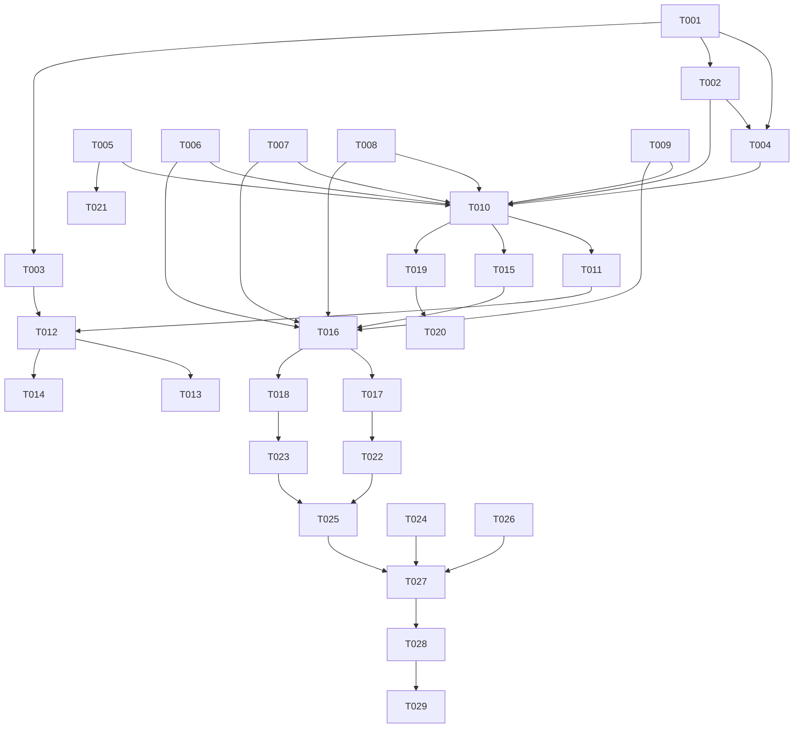

# Tasks: 备份与迁移

**Input**: `spec/backup-migration/spec.md`, `spec/backup-migration/plan.md`
**Prerequisites**: spec.md（必需）、plan.md（必需）

**Tests**: 未要求 TDD；Polish 阶段补序列化/合并决策的纯逻辑单测。

**Organization**: US1 = 导出备份；US2 = 导入合并；US3 = 自动快照。

## Format: `[ID] [P?] [Story] Description`

- **[P]**: 不同文件、无未完成依赖
- **[Story]**: 仅用户故事阶段任务带 `[USx]`
- 路径相对于工程根目录

## Path Conventions

- 源码：`entry/src/main/ets/`
- 资源：`entry/src/main/resources/{base,zh_CN}/element/`
- 测试：`entry/src/ohosTest/ets/test/`

---

## Phase 1: Setup (Shared Infrastructure)

**Purpose**: 常量、模型、文案

- [X] T001 新增备份常量与路由（`BACKUP_VERSION=1`、快照目录名、保留 7 份、`PAGE_BACKUP`、`KEY_LAST_SNAPSHOT_AT`）：`entry/src/main/ets/common/constants/RssConstants.ets`、`entry/src/main/ets/common/constants/RouterConstants.ets`、`entry/src/main/ets/common/constants/PreferencesConstants.ets`
- [X] T002 [P] 新增 `model/Backup.ets`（BackupDocument 与各段 DTO / BackupSummary / SnapshotInfo）：`entry/src/main/ets/model/Backup.ets`
- [X] T003 [P] 新增中英文案（`backup_*`）：`entry/src/main/resources/base/element/string.json`、`entry/src/main/resources/zh_CN/element/string.json`

---

## Phase 2: Foundational (Blocking Prerequisites)

**Purpose**: 序列化、文件、存储层批量读写、服务与 ViewModel

**⚠️ CRITICAL**: 本阶段完成前不要开始用户故事

- [X] T004 [P] 实现 `BackupCodec`（serialize / parse / 版本校验 / mergeArticleState / settingsWhitelist / sanitize）：`entry/src/main/ets/service/BackupCodec.ets`
- [X] T005 [P] 实现 `BackupFiles`（私有目录创建、快照写入/列表/删除/按日期清理）：`entry/src/main/ets/service/BackupFiles.ets`
- [X] T006 `ArticleStore` 备份能力：`allArticlesForBackup`（仅元数据列）/ `mergeArticlesForBackup`（分批事务 + 状态并集）/ `allHighlightsForBackup` / `mergeHighlightsForBackup` / `allArticleTagsForBackup` / `mergeArticleTagsForBackup`：`entry/src/main/ets/service/ArticleStore.ets`
- [X] T007 [P] `TagStore` 备份能力：`allForBackup` / `mergeForBackup`（按 name_key 合并）：`entry/src/main/ets/service/TagStore.ets`
- [X] T008 [P] `SmartFolderStore` / `RuleStore` 备份能力：`allForBackup` / `mergeForBackup`（按 id）：`entry/src/main/ets/service/SmartFolderStore.ets`、`entry/src/main/ets/service/RuleStore.ets`
- [X] T009 `FeedStore.mergeForBackup`（按归一化 URL 合并）与 `SettingsStore.exportWhitelisted` / `applyWhitelisted`：`entry/src/main/ets/service/FeedStore.ets`、`entry/src/main/ets/service/SettingsStore.ets`
- [X] T010 实现 `BackupService`（exportToFile / importFromFile / snapshotNow / maybeAutoSnapshot / listSnapshots / restoreSnapshot / deleteSnapshot / pruneSnapshots）：`entry/src/main/ets/service/BackupService.ets`
- [X] T011 [P] 实现 `BackupViewModel`（exporting/importing/restoring/snapshots/summary/lastError 与编排）：`entry/src/main/ets/viewmodel/BackupViewModel.ets`

**Checkpoint**: 可生成/解析备份、可写快照、合并逻辑就绪

---

## Phase 3: User Story 1 - 导出备份文件 (Priority: P1) 🎯 MVP

**Goal**: 导出 JSON 文件、隐私提示、无凭据

**Independent Test**: 导出后文件可见且包含各段；文件不含密码/Token

- [X] T012 [US1] 新增「备份与恢复」页 `BackupView`（导出/导入 + 恢复设置开关 + 快照列表 + 结果统计 + 隐私提示）：`entry/src/main/ets/views/BackupView.ets`
- [X] T013 [US1] 设置页新增入口并注册 `PAGE_BACKUP`：`entry/src/main/ets/views/SettingsTabView.ets`、`entry/src/main/ets/pages/Index.ets`
- [X] T014 [US1] 导出链路：聚合数据 → 序列化 → DocumentViewPicker 保存；成功/取消/失败提示：`entry/src/main/ets/service/BackupService.ets`、`entry/src/main/ets/viewmodel/BackupViewModel.ets`

**Checkpoint**: US1 可独立验收（导出 + 隐私）

---

## Phase 4: User Story 2 - 导入并合并恢复 (Priority: P1)

**Goal**: 合并导入、幂等、跳过统计、可选设置恢复、导入后刷新

**Independent Test**: 空库完整恢复；已有数据重复导入增量 0；损坏文件不改数据

- [X] T015 [US2] 导入链路：选择文件 → parse/版本校验 → 失败不修改现有数据：`entry/src/main/ets/service/BackupService.ets`
- [X] T016 [US2] 合并执行与统计：feeds/articles/highlights/tags/articleTags/smartFolders/rules/templates（按计划键与状态并集），返回新增/更新/跳过/失败：`entry/src/main/ets/service/BackupService.ets`
- [X] T017 [US2] 跳过与错误边界：feed 不存在、文章缺失、未知字段、单条失败不中断；结果在页面展示：`entry/src/main/ets/service/BackupService.ets`、`entry/src/main/ets/views/BackupView.ets`
- [X] T018 [US2] 导入后刷新：`FeedViewModel` 重新加载订阅与列表；标签/规则/模板计数刷新：`entry/src/main/ets/viewmodel/FeedViewModel.ets`、`entry/src/main/ets/viewmodel/BackupViewModel.ets`

**Checkpoint**: US2 可独立验收（合并 / 幂等 / 跳过）

---

## Phase 5: User Story 3 - 自动快照与恢复 (Priority: P2)

**Goal**: 每日快照、保留 7 份、可恢复/删除/立即备份

**Independent Test**: 启动生成当日快照；第 8 天清理最旧；恢复快照成功

- [X] T019 [US3] 启动自动快照：`Index.onPageShow` 调 `maybeAutoSnapshot`（当日已有则跳过，异步不阻塞）：`entry/src/main/ets/pages/Index.ets`、`entry/src/main/ets/service/BackupService.ets`
- [X] T020 [US3] 快照列表与操作：时间/大小、恢复、删除、立即备份：`entry/src/main/ets/views/BackupView.ets`、`entry/src/main/ets/viewmodel/BackupViewModel.ets`
- [X] T021 [US3] 保留策略：按日期排序保留 7 份，清理更旧；`KEY_LAST_SNAPSHOT_AT` 记录：`entry/src/main/ets/service/BackupService.ets`、`entry/src/main/ets/service/BackupFiles.ets`

**Checkpoint**: 三个故事均可独立工作

---

## Phase 6: Polish & Cross-Cutting Concerns

- [X] T022 [P] 新增 `BackupCodec.test.ets`（版本校验、未知字段、sanitize、状态并集、白名单）：`entry/src/ohosTest/ets/test/BackupCodec.test.ets` 并在 `List.test.ets` 聚合
- [X] T023 [P] 新增 `BackupMerge.test.ets`（合并键、幂等、跳过决策、空备份）：`entry/src/ohosTest/ets/test/BackupMerge.test.ets` 并在 `List.test.ets` 聚合
- [X] T024 [P] 更新 `README.md` 与 `TODO.md`（P2-2 勾选）：`README.md`、`TODO.md`
- [X] T025 全量 `arkts_check` 并修复新增违规：`entry/src/main/ets/`
- [X] T026 纯 V2 自查（无 V1 装饰器 / 无 HdsListItem）：`entry/src/main/ets/`、`AppScope/`

---

## Phase 7: Verification

<!-- verification_scope: build+ui -->

**Purpose**: 构建、部署与逐条用户故事 UI 验证

- [X] T027 构建工程并修复编译错误（`build_project`，增量构建，循环修复直至成功）
- [X] T028 部署到设备并确认启动成功（`start_app`）
- [X] T029 按用户故事执行 UI 验证（每条故事最多 3 次验证尝试）：`verify_ui`

---

## Dependencies & Execution Order

### Phase Dependencies

- **Setup (Phase 1)**: 无依赖
- **Foundational (Phase 2)**: 依赖 Setup，阻塞所有用户故事
- **US1 (Phase 3)**: Foundational 后可开始
- **US2 (Phase 4)**: 依赖 US1 的页面与导出格式
- **US3 (Phase 5)**: 依赖 US1/US2 的序列化与导入
- **Polish (Phase 6)**: 依赖三个故事
- **Verification (Phase 7)**: 依赖 Polish（build+ui）

### User Story Dependencies

- **US1 (P1)**: 可独立验收
- **US2 (P1)**: 依赖 US1
- **US3 (P2)**: 依赖 US1/US2

### Within Each User Story

- Model → Codec/Files → Store → Service → ViewModel → View → 路由
- `BackupService` / `BackupView` / `Index` 为共享文件，相关任务必须串行
- 每个故事完成后再进入下一个



### Parallel Opportunities

| Phase | Tasks | Required Files | Execution Notes |
| --- | --- | --- | --- |
| Setup | T002, T003 | `model/Backup.ets`、`resources/*` | 不同文件，可并行 |
| Foundational | T004, T005, T007, T008, T011 | codec/files/tag/smart/rule/vm | 不同文件，可并行 |
| US1 | T012, T013 | `BackupView.ets`、`SettingsTabView.ets`、`Index.ets` | T013 与 T012 文件不同，可并行 |
| Polish | T022, T023, T024 | `ohosTest/*`、`README.md`、`TODO.md` | 全部可并行 |

## Parallel Example

```text
# Setup 并行
Task: "T002 新增 Backup 模型"
Task: "T003 新增中英文案"

# Foundational 并行
Task: "T004 BackupCodec"
Task: "T005 BackupFiles"
Task: "T007 TagStore 备份能力"
```

## Implementation Strategy

### MVP First（US1）

1. 完成 Setup + Foundational
2. 完成 US1（导出 + 隐私提示）
3. 独立验证：导出文件可读、无凭据
4. 再进入 US2/US3

### Incremental Delivery

1. US1 → 能带数据走
2. US2 → 能合并恢复
3. US3 → 自动快照兜底
4. Polish → 单测与静态检查
5. Verification → 构建 + 部署 + UI

## Notes

- 总任务数 29（T001–T029）：Setup 3、Foundational 8、US1 3、US2 4、US3 3、Polish 5、Verification 3
- 建议 MVP：Setup + Foundational + US1
- 验证范围：build+ui
- UI 验证用例（每条故事一条）：
  - User Story 1: 设置 →「备份与恢复」→ 导出备份 预期：系统保存面板出现（或明确失败提示），页面显示隐私提示；取消不崩溃
  - User Story 2: 用刚导出的文件（或自动快照）导入 预期：显示新增/跳过统计，列表与计数刷新，重复导入不增加条数
  - User Story 3: 冷启动应用后进入备份页 预期：快照列表出现当日一份（时间/大小），可恢复并成功
- 文件选择器在模拟器上可能受限：若无法操作系统保存/选择面板，记录证据并改用自动快照恢复验证导入链路
- `BackupService` / `BackupView` / `Index` 为共享文件，相关任务必须串行
- 备份不含正文与凭据；导入失败不删除现有数据


## 验证补记（2026-10-26，模拟器）

`build+ui` PASS：

- US1 导出：系统保存面板正常，生成 `harmonyrss-backup-20261026.json`（约 419KB）；
  结构校验 version=1、feeds 7 / articles 550 / highlights 2 / tags 1 / articleTags 89 / rules 2 / templates 2 / settings 31；
  凭据字段 0，文章段无正文列。
- US2 导入：修复后成功，统计「更新 550」；重复导入条数不增长（幂等）；导入后列表与计数刷新。
- US3 快照：冷启动自动生成当日快照；列表显示时间/大小；恢复与删除确认后成功；24h 节流生效。

验证中修复的真实缺陷：

1. `BackupFiles.readText` 直接用 `fileIo.readTextSync(选择器 URI)` → `No such file or directory`；
   改为 `openSync + statSync + readSync + TextDecoder`，沙箱路径保留 `readTextSync` 兜底。
2. `OpmlService.readText` 存在同类缺陷（既有代码）→ 同步修复，OPML 导入走同一套 URI 读取。

遗留：
- 重复导入仍会重写全部文章行（条数幂等但非零写入），2 万篇重复导入耗时需关注。
- 快照保留 7 份未做 8 天运行时构造验证（逻辑已核对）。
- `verify_ui` 仍因 4016 不可用，UI 结论来自布局树 + 截图 + 文件/日志取证。
