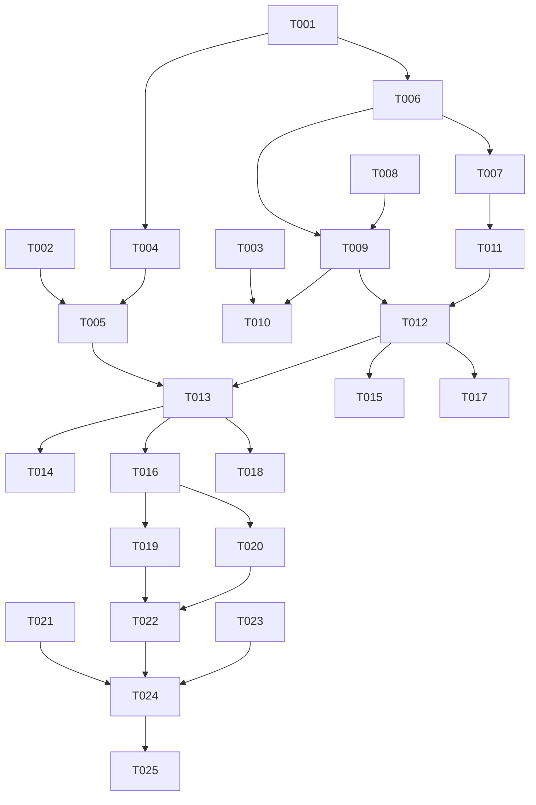

# Tasks: 中文检索性能与分词正确性

**Input**: `spec/cjk-search-perf/spec.md`, `spec/cjk-search-perf/plan.md`
**Prerequisites**: spec.md（必需）、plan.md（必需）

**Tests**: 未要求 TDD；在 Polish 阶段为纯函数（分词、查询编译）补 ohosTest。

**Organization**: US1 = 分词配置与能力探测；US2 = 万级中文查询走索引；US3 = 查询正确性不下降。

## Format: `[ID] [P?] [Story] Description`

- **[P]**: 不同文件、无未完成依赖
- **[Story]**: 仅用户故事阶段任务带 `[USx]`
- 路径相对于工程根目录

## Path Conventions

- 源码：`entry/src/main/ets/`
- 资源：`entry/src/main/resources/{base,zh_CN}/element/`
- 测试：`entry/src/ohosTest/ets/test/`

---

## Phase 1: Setup (Shared Infrastructure)

**Purpose**: 常量、模型、文案骨架

- [X] T001 新增 CJK 索引常量与 schema 版本（`SCHEMA_VERSION` 2→3、`TABLE_ARTICLES_FTS_CJK`、单文档 grams 字符上限、诊断常量）：`entry/src/main/ets/common/constants/RssConstants.ets`
- [X] T002 [P] 新增 `SearchDiagnostics` / `CjkQueryPlan` 模型：`entry/src/main/ets/model/Search.ets`
- [X] T003 [P] 新增检索诊断文案（`search_diag_*`，中英成对）：`entry/src/main/resources/base/element/string.json`、`entry/src/main/resources/zh_CN/element/string.json`

---

## Phase 2: Foundational (Blocking Prerequisites)

**Purpose**: 纯函数与索引基础设施，所有用户故事依赖

**⚠️ CRITICAL**: 本阶段完成前不要开始用户故事

- [X] T004 实现 `CjkTokenizer`（CJK 判定、CJK/非 CJK 片段切分、单字+二元组 grams 生成、查询 token 生成、是否需要复核）：`entry/src/main/ets/service/CjkTokenizer.ets`
- [X] T005 实现 `SearchPlan`（hasCjk、compile 产出 MATCH 表达式与复核关键词、复核 SQL 片段）：`entry/src/main/ets/service/SearchPlan.ets`
- [X] T006 迁移 v3：创建 `articles_fts_cjk(article_id UNINDEXED, grams)`（显式 `tokenize='unicode61'`），并新增 `cjkIndexReady` / `cjkIndexedCount` / `lastSearchPath` / `lastSearchMillis` 状态：`entry/src/main/ets/service/ArticleStore.ets`
- [X] T007 双索引同步：`insertNew` / `setReaderHtml` / `deleteMany` / `deleteByFeed` / `archiveToTrash` / `restoreTrash` 同步维护 CJK 索引，失败不影响主流程：`entry/src/main/ets/service/ArticleStore.ets`

**Checkpoint**: CJK 索引可建、可写、可同步

---

## Phase 3: User Story 1 - 修正分词配置并证明中文可检索 (Priority: P1) 🎯 MVP

**Goal**: 分词配置只保留官方路径；启动能给出中文分词能力的确定结论

**Independent Test**: 启动日志出现 `CJKIDX probe result`，存储页诊断行显示中文分词能力与索引状态

- [X] T008 [US1] 移除 `createFts` 中 `tokenize='icu zh_CN'` 子句，分词器仅由 `StoreConfig.tokenizer` 提供；主索引建表失败仍保留降级：`entry/src/main/ets/service/ArticleStore.ets`
- [X] T009 [US1] 实现 `probeCjkFts()`（临时表 + 中文样本 MATCH，探测后清理），在 `open` 迁移完成后调用，结论写状态并输出 `CJKIDX probe result` 日志：`entry/src/main/ets/service/ArticleStore.ets`
- [X] T010 [US1] 实现 `diagnostics()`（主索引/中文索引就绪、中文分词能力、索引条数、最近检索路径与耗时）并接入存储页「检索索引」分组：`entry/src/main/ets/service/ArticleStore.ets`、`entry/src/main/ets/viewmodel/StorageViewModel.ets`、`entry/src/main/ets/views/StorageView.ets`

**Checkpoint**: 能明确回答「这台设备中文 FTS 是否可用」

---

## Phase 4: User Story 2 - 中文查询在万级数据量下走索引 (Priority: P1)

**Goal**: 含中文的查询一律走 CJK 索引，不再退化为全表 LIKE

**Independent Test**: 1 万篇数据下搜索单字/双字/四字中文词，日志 `search path=cjk` 且首屏达标

- [X] T011 [US2] 实现 `rebuildCjkIndex(onProgress)`：分批 200 条、事务写入、可中断续建、记录已索引条数：`entry/src/main/ets/service/ArticleStore.ets`
- [X] T012 [US2] 检索路由：含 CJK 走 CJK 索引 + 复核；纯英文走原 FTS；两者失败才降级 LIKE；记录路径与耗时并输出日志：`entry/src/main/ets/service/ArticleStore.ets`
- [X] T013 [US2] 在 `search()` 中接入 `SearchPlan`：单字 token、双字二元组、≥3 字二元组 AND + `instr` 子串复核，中英混合对英文片段追加 LIKE 复核：`entry/src/main/ets/service/ArticleStore.ets`
- [X] T014 [US2] CJK 路径下的计数、分页、命中片段（snippet）与过滤条件保持一致：`entry/src/main/ets/service/ArticleStore.ets`
- [X] T015 [US2] 升级后后台自动重建 CJK 索引（不阻塞启动）；新装用户首次插入即双写；重建失败保留旧索引并更新诊断状态：`entry/src/main/ets/service/ArticleStore.ets`

**Checkpoint**: 中文检索确定性走索引

---

## Phase 5: User Story 3 - 查询正确性不下降 (Priority: P2)

**Goal**: 单字、短语、大小写、特殊字符、空查询与降级路径均正确

**Independent Test**: 固定查询集（单字/双字/四字/短语/中英混合/特殊字符/空查询）全部返回预期

- [X] T016 [US3] 特殊字符与空查询保护：引号、`%`、`_`、`*`、控制字符不进入 SQL 语法位；空查询直接返回空页，不触发扫描：`entry/src/main/ets/service/ArticleStore.ets`、`entry/src/main/ets/service/SearchPlan.ets`
- [X] T017 [US3] CJK 索引不可用（建表失败）时回退现有 LIKE 路径，且日志与诊断状态标注 `degraded`：`entry/src/main/ets/service/ArticleStore.ets`
- [X] T018 [US3] 中英混合查询的英文片段复核（大小写不敏感）与结果去重：`entry/src/main/ets/service/ArticleStore.ets`

**Checkpoint**: 性能修复不以正确性为代价

---

## Phase 6: Polish & Cross-Cutting Concerns

- [X] T019 [P] 新增 `CjkTokenizer` 单元测试（单字/二元组/中英混排/标点/长度上限）：`entry/src/ohosTest/ets/test/CjkTokenizer.test.ets` 并在 `entry/src/ohosTest/ets/test/List.test.ets` 聚合
- [X] T020 [P] 新增 `SearchPlan` 单元测试（单字/双字/四字/短语/中英混合/空查询/特殊字符）：`entry/src/ohosTest/ets/test/SearchPlan.test.ets` 并在 `List.test.ets` 聚合
- [X] T021 [P] 更新 `README.md` 检索能力说明（中文索引、诊断入口）：`README.md`
- [X] T022 全量 `arkts_check` 并修复新增违规：`entry/src/main/ets/`
- [X] T023 纯 V2 自查（无 V1 装饰器 / 无 HdsListItem）：`entry/src/main/ets/`、`AppScope/`

---

## Phase 7: Verification

<!-- verification_scope: build-only -->

**Purpose**: 构建与部署验证（含启动日志中的探针与索引建表结论）

- [X] T024 构建工程并修复编译错误（`build_project`，增量构建，循环修复直至成功）
- [X] T025 部署到设备并确认启动成功，采集 `CJKIDX` 日志确认探针结论与索引建表结果（`start_app` + 设备日志）

---

## Dependencies & Execution Order

### Phase Dependencies

- **Setup (Phase 1)**: 无依赖
- **Foundational (Phase 2)**: 依赖 Setup，阻塞所有用户故事
- **US1 (Phase 3)**: Foundational 后开始；是 US2 的诊断前提
- **US2 (Phase 4)**: 依赖 US1 的建表/探测基础设施
- **US3 (Phase 5)**: 依赖 US2 的检索路径
- **Polish (Phase 6)**: 依赖三个故事完成
- **Verification (Phase 7)**: 依赖 Polish（build-only）

### User Story Dependencies

- **US1 (P1)**: 可独立验收（日志 + 诊断状态）
- **US2 (P1)**: 依赖 US1，验收需 1 万篇数据下的路径与耗时
- **US3 (P2)**: 依赖 US2，验收用固定查询集

### Within Each User Story

- 纯函数 → 存储层 → 检索路径 → 诊断/UI
- `ArticleStore.ets` 内任务必须顺序执行
- 每个故事完成后再进入下一个优先级



### Parallel Opportunities

| Phase | Tasks | Required Files | Execution Notes |
| --- | --- | --- | --- |
| Setup | T002, T003 | `model/Search.ets`、`resources/*/string.json` | 不同文件，可并行；T001 先完成 |
| Foundational | T004, T005 | `service/CjkTokenizer.ets`、`service/SearchPlan.ets` | T005 依赖 T004 的类型，建议顺序；其余可并行 |
| US1 | T010 | `StorageViewModel.ets`、`StorageView.ets` | 依赖 T009 状态接口，单独执行 |
| Polish | T019, T020, T021 | `entry/src/ohosTest/ets/test/*`、`README.md` | 全部可并行 |

## Parallel Example

```text
# Setup 并行
Task: "T002 新增 Search 诊断模型"
Task: "T003 新增诊断文案"

# Polish 并行
Task: "T019 CjkTokenizer 单测"
Task: "T020 SearchPlan 单测"
Task: "T021 README 更新"
```

## Implementation Strategy

### MVP First（US1）

1. 完成 Setup + Foundational
2. 完成 US1（配置修正 + 探针 + 诊断）
3. 部署后看日志确认「中文 FTS 是否可用」
4. 再进入 US2 索引路径

### Incremental Delivery

1. US1 → 可诊断
2. US2 → 中文走索引
3. US3 → 正确性回归
4. Polish → 单测与静态检查
5. Verification → 构建 + 部署 + 日志确认

## Notes

- 总任务数 25（T001–T025）：Setup 3、Foundational 4、US1 3、US2 5、US3 3、Polish 5、Verification 2
- 建议 MVP：Setup + Foundational + US1
- 验证范围：build-only（构建 + 部署 + 启动日志确认，不做逐条 UI 验证）
- `ArticleStore.ets` 是单文件瓶颈，T006–T018 中涉及它的任务必须串行
- 性能验收以设备日志 `search path=cjk` 与耗时为准；1 万篇压测可用现有数据观察

## 补验记录（2026-10-22，build+ui）

`build-only` 验证通过后追加了一轮真机/模拟器 UI 验证，发现并修复 2 个阻断性缺陷：

1. **FTS `MATCH` 使用了表别名**：`WHERE f MATCH ?` 在 SQLite 中直接解析失败（`no such column: f`），
   而计数/取页 helper 吞掉异常，导致所有搜索（中英文）都静默返回 0。已改为 `WHERE articles_fts(_cjk) MATCH ?`，
   并让检索路径的 SQL 错误向上抛、降级到 LIKE。
2. **FTS5 虚表 `COUNT(*)` 返回 0**：诊断条数恒为 0，且启动时误判「索引为空」反复全量重建。
   已改用 `<table>_docsize` 影子表计数，回退到虚表 COUNT。
3. 存储页首次进入可能显示 0/0（异步加载后 V2 未及时重绘），重新进入即正确；建议后续在 `onPageShow` 再刷一次诊断。

实测（模拟器，98 篇）：

| 查询 | 路径 | 耗时 | 结果 |
| --- | --- | --- | --- |
| `发布`（双字） | cjk | 11ms | 6 |
| `发`（单字） | cjk | 13ms | 9 |
| `荣耀发布`（四字） | cjk | 22ms | 1 |
| `荣耀 WIN2`（混排） | cjk | 36ms | 1 |
| `鸿蒙` | cjk | 13ms | 0（语料无此词，路径已确认） |
| `Pokemon` | fts | 10ms | 1 |

索引诊断：主索引 98 条 / 中文索引 98 条；探针 `unavailable`（模拟器无中文分词，符合预期，中文走二元组索引）。

### 真机复验（2026-10-22，PLR-AL00 / Mate 70 Pro，104 篇）

发现并修复第 3 个缺陷：**主索引条数只增不减地缺失**（`main=79 cjk=104`）。
`ensureMainIndex()` 原先只在索引为 0 时重建，FTS 表尚不存在时入库的历史文章永远补不回来。
已改为「索引条数 != 文章总数」即重建；重启后 `main index mismatch indexed=79 total=104` → `main=104 cjk=104`。

| 查询 | 路径 | 耗时 | 结果 |
| --- | --- | --- | --- |
| `发布`（双字，冷/热） | cjk | 50ms / 32–39ms | 13 |
| `发`（单字） | cjk | 38ms | 14 |
| `荣耀发布`（四字） | cjk | 10ms | 1 |
| `荣耀 WIN2`（混排） | cjk | 19ms | 1 |
| `Rust`（英文） | fts | 40ms | 2 |
| `Pokemon`（英文，修复前 0） | fts | 30ms | 1 |

真机探针同样为 `unavailable`：该机型 FTS 默认分词器不切分中文，验证了「CJK 二元组索引」是必要路径而非可选兜底。
