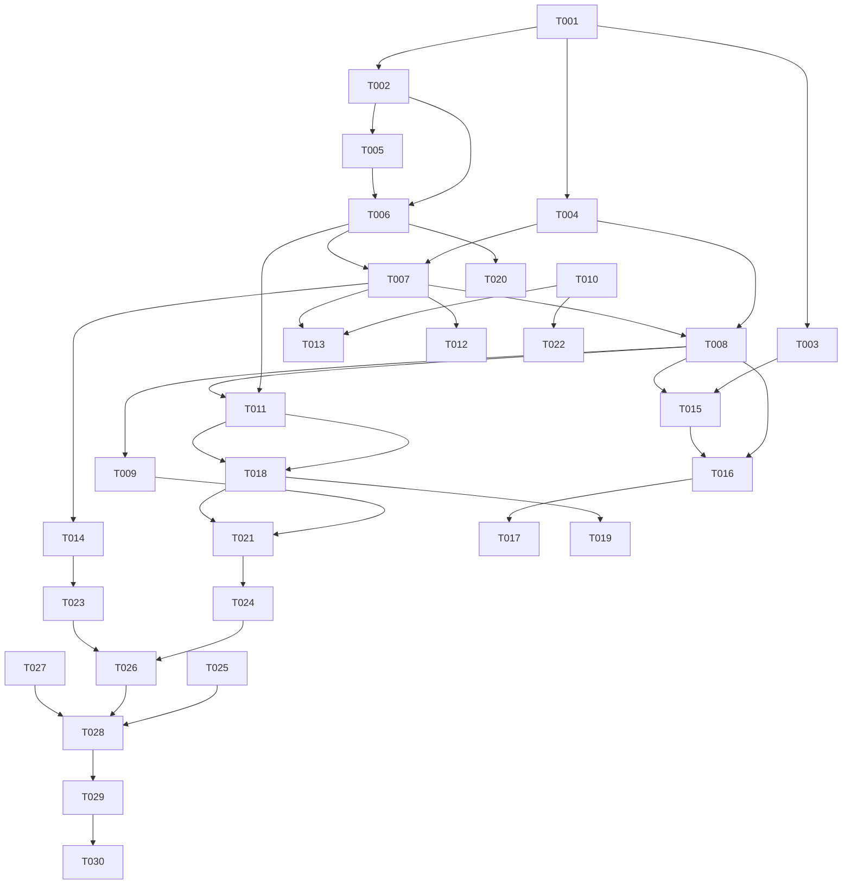

# Tasks: 跨源去重

**Input**: `spec/dedupe/spec.md`, `spec/dedupe/plan.md`
**Prerequisites**: spec.md（必需）、plan.md（必需）

**Tests**: 未要求 TDD；Polish 阶段补归一化与匹配决策的纯逻辑单测。

**Organization**: US1 = 自动合并；US2 = 来源可见；US3 = 状态与生命周期。

## Format: `[ID] [P?] [Story] Description`

- **[P]**: 不同文件、无未完成依赖
- **[Story]**: 仅用户故事阶段任务带 `[USx]`
- 路径相对于工程根目录

## Path Conventions

- 源码：`entry/src/main/ets/`
- 资源：`entry/src/main/resources/{base,zh_CN}/element/`
- 测试：`entry/src/ohosTest/ets/test/`

---

## Phase 1: Setup (Shared Infrastructure)

**Purpose**: 常量、模型、文案

- [X] T001 新增去重常量与 schema 版本（`SCHEMA_VERSION` 6→7、`link_key`/`title_key`/`canonical_id` 列名与索引、24h 窗口、单组来源上限）与偏好 key：`entry/src/main/ets/common/constants/RssConstants.ets`、`entry/src/main/ets/common/constants/PreferencesConstants.ets`
- [X] T002 [P] `Article` 增加 `canonicalId` / `duplicateCount` / `linkKey` / `titleKey`，并新增 `model/Dedupe.ets`（DedupeCandidate / DedupeMatch / GroupSource）：`entry/src/main/ets/model/Feed.ets`、`entry/src/main/ets/model/Dedupe.ets`
- [X] T003 [P] 新增中英文案（`dedupe_*`）：`entry/src/main/resources/base/element/string.json`、`entry/src/main/resources/zh_CN/element/string.json`

---

## Phase 2: Foundational (Blocking Prerequisites)

**Purpose**: 迁移、归一化、匹配、组操作

**⚠️ CRITICAL**: 本阶段完成前不要开始用户故事

- [X] T004 `ArticleStore` v7 迁移：加 3 列 + 3 索引；最新版本 IF NOT EXISTS 自愈；新增 `backfillDedupeKeys(limit)` 分批补键：`entry/src/main/ets/service/ArticleStore.ets`
- [X] T005 [P] 实现 `DedupeKeys` 纯函数（urlKey / titleKey / sameTitleWindow）：`entry/src/main/ets/service/DedupeKeys.ets`
- [X] T006 实现 `DedupeService`（findMatches / resolveRoot / groupIds / expandIds / applyRead / applyStarred / applyHidden / applyTag / promoteIfNeeded / pickPromotion）：`entry/src/main/ets/service/DedupeService.ets`
- [X] T007 `insertNew` / `insertRemote` 接入去重：批量算键 → 两次 IN 查询匹配 → 写 canonical_id；重复项跳过 FTS/中文索引；异常降级为独立文章：`entry/src/main/ets/service/ArticleStore.ets`
- [X] T008 查询层排除重复项：列表 SQL 增加 `canonical_id = ''` 并回填 `duplicateCount`（子查询）；搜索、标签文章、未读统计同步排除；新增 `loadGroupSources` / `groupIdsOf`：`entry/src/main/ets/service/ArticleStore.ets`
- [X] T009 生命周期：`deleteMany` / `archiveToTrash` / `restoreTrash` / `purgeTrash` 前后提升主条并重指向；无剩余时整组处理：`entry/src/main/ets/service/ArticleStore.ets`
- [X] T010 去重开关：`AppSettings.dedupeEnabled`（默认 true）、`SettingsStore` 读写、`SettingsViewModel` setter：`entry/src/main/ets/model/AppSettings.ets`、`entry/src/main/ets/service/SettingsStore.ets`、`entry/src/main/ets/viewmodel/SettingsViewModel.ets`
- [X] T011 `FeedViewModel`：状态操作经 `DedupeService` 展开；`hiddenCount` / 未读 / 归档 / 单源列表排除重复项；`setHidden` 组同步：`entry/src/main/ets/viewmodel/FeedViewModel.ets`

**Checkpoint**: 入库可合并、组操作可用、列表只出现主条

---

## Phase 3: User Story 1 - 不同源的同篇文章只出现一次 (Priority: P1) 🎯 MVP

**Goal**: 入库自动合并、开关生效、失败降级

**Independent Test**: 构造同 URL 与同标题 ±24h 的两条文章，列表只出现一条；关闭开关后不合并

- [X] T012 [US1] 启动后台补键接入：`FeedViewModel.init` 在索引回填后调用 `backfillDedupeKeys`（分批、失败不阻塞）：`entry/src/main/ets/viewmodel/FeedViewModel.ets`
- [X] T013 [US1] 去重开关接入插入路径：关闭时不再匹配（键照常写入），重新开启后可并入已有主条：`entry/src/main/ets/service/ArticleStore.ets`
- [X] T014 [US1] 重复入库幂等：同一文章多次同步不产生新主条/重复挂靠；匹配异常降级独立文章并记日志：`entry/src/main/ets/service/ArticleStore.ets`、`entry/src/main/ets/service/DedupeService.ets`

**Checkpoint**: US1 可独立验收（合并 / 开关 / 幂等）

---

## Phase 4: User Story 2 - 来源出处可见 (Priority: P1)

**Goal**: 列表多来源标识、详情来源列表

**Independent Test**: 合并文章列表显示「N 个来源」；详情列出全部来源并可打开链接

- [X] T015 [US2] `ArticleListItem` 在 `duplicateCount > 1` 时显示「N 个来源」chip：`entry/src/main/ets/views/ArticleListItem.ets`
- [X] T016 [US2] `ArticleDetailView` 加载 `loadGroupSources` 并在标题下展示来源区（源名 + 打开链接），仅 >1 时显示：`entry/src/main/ets/views/ArticleDetailView.ets`
- [X] T017 [US2] `FeedViewModel` 确保列表项 `duplicateCount` 正确回填（详情页取组来源），并在组变化后刷新：`entry/src/main/ets/viewmodel/FeedViewModel.ets`

**Checkpoint**: US2 可独立验收（标识 + 来源列表）

---

## Phase 5: User Story 3 - 状态与生命周期在组内一致 (Priority: P1)

**Goal**: 状态/标签/隐藏组同步、远端覆盖、主条提升

**Independent Test**: 主条已读 → 组内全已读且未读只减 1；删除主条后新主条出现

- [X] T018 [US3] `FeedViewModel` 已读/收藏/隐藏/批量/读完改走组展开（含规则产生的状态）：`entry/src/main/ets/viewmodel/FeedViewModel.ets`
- [X] T019 [US3] 远端同步：新增 `enqueueGroupState`（组展开逐个入队）；远端状态回写先解析主条再作用整组：`entry/src/main/ets/service/remote/RemoteSyncService.ets`
- [X] T020 [US3] 规则引擎：`RuleService.applyToNew` 执行前把计划 id 展开为组 id；命中统计按主条只计一次：`entry/src/main/ets/service/RuleService.ets`
- [X] T021 [US3] 删除/清理主条提升接线与组内重指向，恢复后无悬挂引用；取消隐藏对整组生效：`entry/src/main/ets/service/ArticleStore.ets`、`entry/src/main/ets/viewmodel/FeedViewModel.ets`
- [X] T022 [US3] 设置页新增「跨源去重」开关行（默认开）与说明：`entry/src/main/ets/views/SettingsTabView.ets`

**Checkpoint**: 三个故事均可独立工作

---

## Phase 6: Polish & Cross-Cutting Concerns

- [X] T023 [P] 新增 `DedupeKeys.test.ets`（URL 跟踪参数/锚点/大小写/尾斜杠、标题标点/空白、24h 边界）：`entry/src/ohosTest/ets/test/DedupeKeys.test.ets` 并在 `List.test.ets` 聚合
- [X] T024 [P] 新增 `DedupePlan.test.ets`（候选匹配、根解析、组展开、主条提升选择、幂等）：`entry/src/ohosTest/ets/test/DedupePlan.test.ets` 并在 `List.test.ets` 聚合
- [X] T025 [P] 更新 `README.md` 与 `TODO.md`（P1-2 去重勾选）：`README.md`、`TODO.md`
- [X] T026 全量 `arkts_check` 并修复新增违规：`entry/src/main/ets/`
- [X] T027 纯 V2 自查（无 V1 装饰器 / 无 HdsListItem）：`entry/src/main/ets/`、`AppScope/`

---

## Phase 7: Verification

<!-- verification_scope: build+ui -->

**Purpose**: 构建、部署与逐条用户故事 UI 验证

- [X] T028 构建工程并修复编译错误（`build_project`，增量构建，循环修复直至成功）
- [X] T029 部署到设备并确认启动成功（`start_app`）
- [X] T030 按用户故事执行 UI 验证（每条故事最多 3 次验证尝试）：`verify_ui`

---

## Dependencies & Execution Order

### Phase Dependencies

- **Setup (Phase 1)**: 无依赖
- **Foundational (Phase 2)**: 依赖 Setup，阻塞所有用户故事
- **US1 (Phase 3)**: Foundational 后可开始
- **US2 (Phase 4)**: 依赖 US1 产生的合并组
- **US3 (Phase 5)**: 依赖 US1/US2 的组与来源
- **Polish (Phase 6)**: 依赖三个故事
- **Verification (Phase 7)**: 依赖 Polish（build+ui）

### User Story Dependencies

- **US1 (P1)**: 可独立验收
- **US2 (P1)**: 依赖 US1
- **US3 (P1)**: 依赖 US1

### Within Each User Story

- Model → 归一化/匹配 → Store → Service → ViewModel → View
- `ArticleStore` / `FeedViewModel` 为共享文件，相关任务必须串行
- 每个故事完成后再进入下一个



### Parallel Opportunities

| Phase | Tasks | Required Files | Execution Notes |
| --- | --- | --- | --- |
| Setup | T002, T003 | `model/{Feed,Dedupe}.ets`、`resources/*` | 不同文件，可并行 |
| Foundational | T005, T010 | `service/DedupeKeys.ets`、设置三件套 | 不同文件，可并行 |
| US2 | T015, T016 | `views/ArticleListItem.ets`、`views/ArticleDetailView.ets` | 不同文件，可并行 |
| Polish | T023, T024, T025 | `ohosTest/*`、`README.md`、`TODO.md` | 全部可并行 |

## Parallel Example

```text
# Setup 并行
Task: "T002 新增 Dedupe 模型与 Article 字段"
Task: "T003 新增中英文案"

# US2 并行
Task: "T015 列表多来源标识"
Task: "T016 详情来源区"
```

## Implementation Strategy

### MVP First（US1）

1. 完成 Setup + Foundational
2. 完成 US1（合并 + 开关 + 幂等）
3. 独立验证：同 URL / 同标题 ±24h / 关闭开关
4. 再进入 US2/US3

### Incremental Delivery

1. US1 → 列表不再重复
2. US2 → 来源可见
3. US3 → 状态与生命周期一致
4. Polish → 单测与静态检查
5. Verification → 构建 + 部署 + UI

## Notes

- 总任务数 30（T001–T030）：Setup 3、Foundational 8、US1 3、US2 3、US3 5、Polish 5、Verification 3
- 建议 MVP：Setup + Foundational + US1
- 验证范围：build+ui
- UI 验证用例（每条故事一条）：
  - User Story 1: 让两个不同订阅源收录同一 URL 的文章（可用两个真实源，或通过测试数据构造） 预期：列表只出现一条，来源数为 2
  - User Story 2: 打开该合并文章详情 预期：标题下显示来源区，列出两个源名并可分别打开
  - User Story 3: 给主条标已读并删除主条 预期：组内全部已读、未读只减 1；删除后组内另一篇自动成为新的主条并仍在列表
- 若无法构造自然重复：允许用设备数据库注入两条同 URL 测试数据（记录方式与证据），不得修改生产逻辑
- `ArticleStore.ets` / `FeedViewModel.ets` 为共享文件，相关任务必须串行
- 误合并风险：同标题不同文在 24h 内可能合并；保留来源区以便辨识


## 验证补记（2026-10-22，模拟器）

`build+ui` 验证：构建一次通过、部署启动正常；US1（列表单条 + 2 个来源）与 US2（详情来源 chip + 面板）通过；
US3 的「组内已读同步」经 UI + DB 双取证通过。

**环境限制**：模拟器上 AlertDialog / bindMenu 不接受 `uitest uiInput` 注入（取消/确认均无效），
无法通过 UI 触发「删除主条」。改用集成用例 `DedupeIntegration.test.ets` 直接验证：
交叉源同 URL 入库 → 后入库挂靠；组内已读同步；`deleteMany` 主条后另一篇提升为 `canonical_id=''` 且仍可读取；测试数据已清理。
结果：`Tests run: 1, Failure: 0, Error: 0, Pass: 1`。

遗留：
- 搜索结果行暂不显示「N 个来源」（列表与详情已显示）。
- 「关闭去重后新增不合并」仅有代码路径与开关默认值确认，未做端到端。
- 标题键（±24h）合并路径仅单测覆盖，真实数据未命中。
- `ArticleStore ↔ DedupeService` 循环 import 构建/运行正常，建议后续把纯决策函数迁出以消除隐患。
