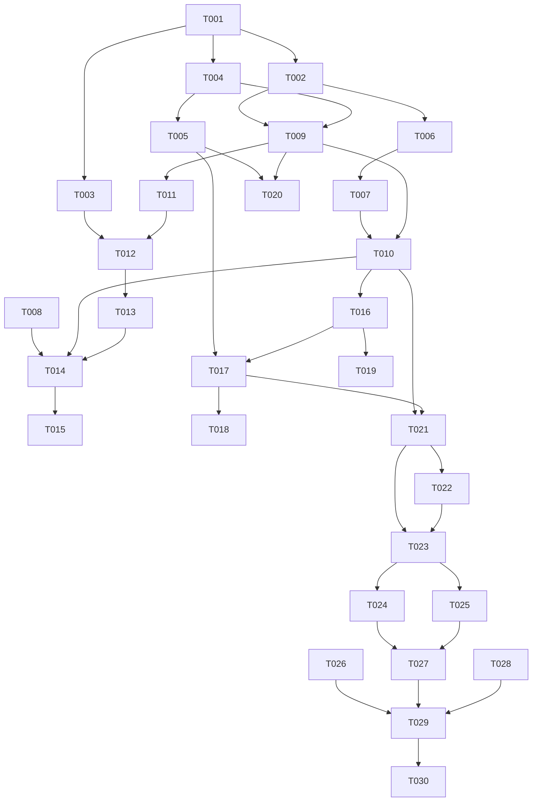

# Tasks: FreshRSS 兼容服务接入（Google Reader API）

**Input**: `spec/freshrss-client/spec.md`, `spec/freshrss-client/plan.md`
**Prerequisites**: spec.md（必需）、plan.md（必需）

**Tests**: 未要求 TDD；Polish 阶段补协议解析与同步决策的纯逻辑单测。

**Organization**: US1 = 连接服务；US2 = 同步订阅与文章；US3 = 已读/收藏双向。

## Format: `[ID] [P?] [Story] Description`

- **[P]**: 不同文件、无未完成依赖
- **[Story]**: 仅用户故事阶段任务带 `[USx]`
- 路径相对于工程根目录

## Path Conventions

- 源码：`entry/src/main/ets/`
- 资源：`entry/src/main/resources/{base,zh_CN}/element/`、`entry/src/main/resources/base/profile/`
- 测试：`entry/src/ohosTest/ets/test/`

---

## Phase 1: Setup (Shared Infrastructure)

**Purpose**: 常量、模型、平台配置与文案

- [X] T001 新增远端账号常量与 schema 版本（`SCHEMA_VERSION` 4→5、四张表名、同步上限与间隔常量）与 `PAGE_REMOTE` 路由、远端自动同步偏好 key：`entry/src/main/ets/common/constants/RssConstants.ets`、`entry/src/main/ets/common/constants/RouterConstants.ets`、`entry/src/main/ets/common/constants/PreferencesConstants.ets`
- [X] T002 [P] 新增领域模型 `RemoteAccount` / `RemoteFeed` / `RemoteArticle` / `SyncStatus` / `SyncResult` / `OutboxItem`：`entry/src/main/ets/model/Remote.ets`
- [X] T003 [P] 新增中英文案（`remote_*`）与明文网络配置：`entry/src/main/resources/base/element/string.json`、`entry/src/main/resources/zh_CN/element/string.json`、`entry/src/main/resources/base/profile/network_config.json`

---

## Phase 2: Foundational (Blocking Prerequisites)

**Purpose**: 数据层、协议层、凭据与同步编排

**⚠️ CRITICAL**: 本阶段完成前不要开始用户故事

- [X] T004 `ArticleStore` 迁移 v5：建 `remote_accounts` / `sync_state` / `remote_article_map` / `sync_outbox` 与索引；最新版本也执行 `CREATE TABLE IF NOT EXISTS` 自愈：`entry/src/main/ets/service/ArticleStore.ets`
- [X] T005 `ArticleStore` 远端文章能力：`insertRemote(articles, mappings)`（事务内插文章 + 映射 + 双索引，已存在 link 只补映射）、`setReadByRemote` / `setStarredByRemote`（只改状态）：`entry/src/main/ets/service/ArticleStore.ets`
- [X] T006 新增协议 DTO 与解析 `GReaderModels`（订阅 / 文章 / id 列表 / ClientLogin 响应 / 错误映射，字段缺失容错）：`entry/src/main/ets/service/remote/GReaderModels.ets`
- [X] T007 新增 `GReaderClient`（probe / login / fetchSubscriptions / fetchContents / fetchUnreadIds / fetchStarredIds / fetchWriteToken / editTag；超时、分类错误、http/https）：`entry/src/main/ets/service/remote/GReaderClient.ets`
- [X] T008 [P] 新增 `RemoteCredentials`（Asset Store add/query/remove，别名 `rss_remote_<id>`）：`entry/src/main/ets/service/remote/RemoteCredentials.ets`
- [X] T009 新增 `RemoteAccountStore`（账号 CRUD、sync_state 读写、remote_article_map、sync_outbox 聚合/待同步/确认/失败计数）：`entry/src/main/ets/service/RemoteAccountStore.ets`
- [X] T010 新增 `RemoteSyncService` 骨架：connect / syncNow / maybeAutoSync / logout / status，以及纯函数 `mergeFeeds` / `decideState` / `buildEditTagBatches`：`entry/src/main/ets/service/remote/RemoteSyncService.ets`
- [X] T011 新增 `RemoteAccountViewModel`（表单状态、测试连接、同步状态、立即同步、退出登录）：`entry/src/main/ets/viewmodel/RemoteAccountViewModel.ets`

**Checkpoint**: 协议与存储可独立调用

---

## Phase 3: User Story 1 - 连接自己的 RSS 服务 (Priority: P1) 🎯 MVP

**Goal**: 表单连接、错误分类、状态可见、退出登录

**Independent Test**: 输入地址/账号/密码，成功显示订阅数；错误分别提示网络/证书/凭据/API/服务端

- [X] T012 [US1] 新增「账号与服务」页 `RemoteServiceView`（地址 / 用户名 / 密码 / 允许 http / 连接 / 状态卡 / 立即同步 / 退出登录）：`entry/src/main/ets/views/RemoteServiceView.ets`
- [X] T013 [US1] 设置页新增入口并注册 `PAGE_REMOTE` 路由：`entry/src/main/ets/views/SettingsTabView.ets`、`entry/src/main/ets/pages/Index.ets`
- [X] T014 [US1] 连接链路：Base URL 归一 → probe → ClientLogin → 存凭据/账号 → 首次同步；失败按错误类型提示且保留表单：`entry/src/main/ets/service/remote/RemoteSyncService.ets`、`entry/src/main/ets/viewmodel/RemoteAccountViewModel.ets`
- [X] T015 [US1] 退出登录（默认保留本地数据，可选清除）与状态刷新：`entry/src/main/ets/viewmodel/RemoteAccountViewModel.ets`、`entry/src/main/ets/views/RemoteServiceView.ets`

**Checkpoint**: US1 可独立验收（连接 / 错误 / 状态 / 退出）

---

## Phase 4: User Story 2 - 同步订阅与文章 (Priority: P1)

**Goal**: 合并订阅、增量拉文章、去重、断点续传、来源状态

**Independent Test**: 首次同步后订阅与文章可见；重复同步无重复；中断后续传

- [X] T016 [US2] 订阅合并：远端订阅按 URL 归一化合并到本地（保留本地独有源），写入 `FeedStore` 并刷新 `FeedViewModel`：`entry/src/main/ets/service/remote/RemoteSyncService.ets`
- [X] T017 [US2] 文章拉取：按源分页（100/页、最多 10 页）→ 转换 `Article`（`buildArticleId`）→ `insertRemote` 建映射 → 更新每源游标：`entry/src/main/ets/service/remote/RemoteSyncService.ets`
- [X] T018 [US2] 同步上限与去重：单源 100 篇 / 单次 2000 篇，重复 remote_id 与重复 link 均不重复插入；同步进度文案：`entry/src/main/ets/service/remote/RemoteSyncService.ets`、`entry/src/main/ets/views/RemoteServiceView.ets`
- [X] T019 [US2] 回前台自动同步：`Index.onPageShow` 调用 `maybeAutoSync()`，按设置间隔判断：`entry/src/main/ets/pages/Index.ets`、`entry/src/main/ets/service/remote/RemoteSyncService.ets`

**Checkpoint**: US2 可独立验收（合并 / 增量 / 去重 / 续传）

---

## Phase 5: User Story 3 - 已读 / 收藏双向同步 (Priority: P1)

**Goal**: 本地变更入队并回写，远端变更拉回，冲突确定性收敛

**Independent Test**: 本地标 50 篇已读 → 同步 → 远端一致；远端改收藏 → 本地变化；离线变更恢复后补发

- [X] T020 [US3] 本地变更入队：`FeedViewModel` 的已读/收藏/批量/读完操作后调用 `enqueueState`（未连接时零开销返回）：`entry/src/main/ets/viewmodel/FeedViewModel.ets`
- [X] T021 [US3] 回写：取 `sync_outbox` 每批 50 条 → `fetchWriteToken` → `editTag` → 成功确认、失败累加重试与错误：`entry/src/main/ets/service/remote/RemoteSyncService.ets`
- [X] T022 [US3] 拉回：分页取未读 id / 收藏 id 集合 → 对已映射文章只更新状态字段（不覆盖正文/进度/标签）：`entry/src/main/ets/service/remote/RemoteSyncService.ets`
- [X] T023 [US3] 冲突与待同步展示：push-first 策略（本地未推送优先）、账号页显示待同步条数与连续失败：`entry/src/main/ets/service/remote/RemoteSyncService.ets`、`entry/src/main/ets/views/RemoteServiceView.ets`

**Checkpoint**: 三个故事均可独立工作

---

## Phase 6: Polish & Cross-Cutting Concerns

- [X] T024 [P] 新增 `GReaderModels.test.ets`（JSON 字段缺失容错、订阅 id 解析、错误映射）：`entry/src/ohosTest/ets/test/GReaderModels.test.ets` 并在 `List.test.ets` 聚合
- [X] T025 [P] 新增 `RemoteSyncPlan.test.ets`（订阅合并、冲突决策、edit-tag 分批）：`entry/src/ohosTest/ets/test/RemoteSyncPlan.test.ets` 并在 `List.test.ets` 聚合
- [X] T026 [P] 更新 `README.md` 与 `TODO.md` 进度：`README.md`、`TODO.md`
- [X] T027 全量 `arkts_check` 并修复新增违规：`entry/src/main/ets/`
- [X] T028 纯 V2 自查（无 V1 装饰器 / 无 HdsListItem）：`entry/src/main/ets/`、`AppScope/`

---

## Phase 7: Verification

<!-- verification_scope: build-only -->

**Purpose**: 构建与部署验证

- [X] T029 构建工程并修复编译错误（`build_project`，增量构建，循环修复直至成功）
- [X] T030 部署到设备并确认启动成功（`start_app`）

---

## Dependencies & Execution Order

### Phase Dependencies

- **Setup (Phase 1)**: 无依赖
- **Foundational (Phase 2)**: 依赖 Setup，阻塞所有用户故事
- **US1 (Phase 3)**: Foundational 后可开始
- **US2 (Phase 4)**: 依赖 US1 的连接与账号
- **US3 (Phase 5)**: 依赖 US1/US2 的映射与同步骨架
- **Polish (Phase 6)**: 依赖三个故事
- **Verification (Phase 7)**: 依赖 Polish（build-only）

### User Story Dependencies

- **US1 (P1)**: 可独立验收
- **US2 (P1)**: 依赖 US1
- **US3 (P1)**: 依赖 US2 的文章映射

### Within Each User Story

- Model → Client → Store → Service → ViewModel → View → 路由
- `ArticleStore` / `RemoteSyncService` / `Index` 为共享文件，相关任务必须串行
- 每个故事完成后再进入下一个



### Parallel Opportunities

| Phase | Tasks | Required Files | Execution Notes |
| --- | --- | --- | --- |
| Setup | T002, T003 | `model/Remote.ets`、`resources/*` | 不同文件，可并行 |
| Foundational | T008 | `service/remote/RemoteCredentials.ets` | 与协议层无文件冲突 |
| Polish | T024, T025, T026 | `ohosTest/*`、`README.md`、`TODO.md` | 全部可并行 |

## Parallel Example

```text
# Setup 并行
Task: "T002 新增 Remote 模型"
Task: "T003 新增中英文案与网络配置"

# Polish 并行
Task: "T024 GReaderModels 单测"
Task: "T025 RemoteSyncPlan 单测"
Task: "T026 更新 README / TODO"
```

## Implementation Strategy

### MVP First（US1）

1. 完成 Setup + Foundational
2. 完成 US1（连接 + 错误分类 + 状态 + 退出）
3. 独立验证：正确/错误凭据、地址不可达、API 未开启
4. 再进入 US2/US3

### Incremental Delivery

1. US1 → 能连上
2. US2 → 订阅与文章进来
3. US3 → 状态双向
4. Polish → 单测与静态检查
5. Verification → 构建 + 部署

## Notes

- 总任务数 30（T001–T030）：Setup 3、Foundational 8、US1 4、US2 4、US3 4、Polish 5、Verification 2
- 建议 MVP：Setup + Foundational + US1
- 验证范围：build-only（端到端同步需要真实 FreshRSS 实例，后续单独联调）
- 真实联调前建议准备：FreshRSS 实例 + 开启 API + 测试账号；HTTPS 自签需部署侧信任或使用 http
- 明文 http 为全局配置（`network_config.json`），上线前需评估安全说明
- `RemoteSyncService` 为单文件瓶颈，T010/T014/T016/T017/T021/T022 必须串行
