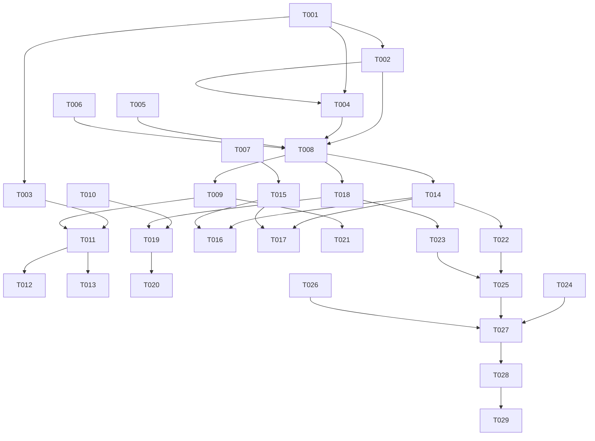

# Tasks: 通知增强

**Input**: `spec/notify-enhance/spec.md`, `spec/notify-enhance/plan.md`
**Prerequisites**: spec.md（必需）、plan.md（必需）

**Tests**: 未要求 TDD；Polish 阶段补策略与队列的纯逻辑单测。

**Organization**: US1 = 通知策略；US2 = 免打扰与摘要；US3 = 分组/动作/直达。

## Format: `[ID] [P?] [Story] Description`

- **[P]**: 不同文件、无未完成依赖
- **[Story]**: 仅用户故事阶段任务带 `[USx]`
- 路径相对于工程根目录

## Path Conventions

- 源码：`entry/src/main/ets/`
- 资源：`entry/src/main/resources/{base,zh_CN}/element/`
- 测试：`entry/src/ohosTest/ets/test/`

---

## Phase 1: Setup (Shared Infrastructure)

**Purpose**: 常量、模型、文案

- [X] T001 新增通知常量与路由（每源 3 / 总量 10 / 队列 50 / 关键词 20；策略与队列偏好 key；`PAGE_NOTIFY_SETTINGS`）：`entry/src/main/ets/common/constants/CommonConstants.ets`、`entry/src/main/ets/common/constants/PreferencesConstants.ets`、`entry/src/main/ets/common/constants/RouterConstants.ets`
- [X] T002 [P] 新增 `model/Notify.ets`（NotifyPolicy / NotifyQueueItem / NotifyItem / NotifyPlan），并给 `AppSettings` 增加免打扰/摘要/关键词字段：`entry/src/main/ets/model/Notify.ets`、`entry/src/main/ets/model/AppSettings.ets`
- [X] T003 [P] 新增中英文案（`notify_*`）：`entry/src/main/resources/base/element/string.json`、`entry/src/main/resources/zh_CN/element/string.json`

---

## Phase 2: Foundational (Blocking Prerequisites)

**Purpose**: 策略、存储、发布、深链

**⚠️ CRITICAL**: 本阶段完成前不要开始用户故事

- [X] T004 [P] 实现 `NotifyPolicy` 纯函数（inDnd / matchesKeywords / filter / plan / digestDue）：`entry/src/main/ets/service/NotifyPolicy.ets`
- [X] T005 [P] 实现 `NotifyStore`（策略 / 队列 / 摘要日期的偏好读写）：`entry/src/main/ets/service/NotifyStore.ets`
- [X] T010 修改 `DeepLink` 新增 `ACTION_STAR='star'`；`Index` 处理 star 动作（标记收藏 + 远端入队）：`entry/src/main/ets/service/DeepLink.ets`、`entry/src/main/ets/pages/Index.ets`
- [X] T006 `SettingsStore` 读写免打扰/摘要/关键词字段（归一与脏值降级）：`entry/src/main/ets/service/SettingsStore.ets`
- [X] T007 [P] `ArticleStore` 新增 `articlesFetchedSince(ts)`（当天新文章，轻量列）：`entry/src/main/ets/service/ArticleStore.ets`
- [X] T008 改造 `NotifyService`：`notifyNew` / `flushQueueIfDue` / `maybeSendDigest` / `publishItem` / `publishAggregate` / `testNotification`；分组、限流、动作按钮、权限降级：`entry/src/main/ets/service/NotifyService.ets`
- [X] T009 [P] 新增 `NotifyViewModel`（策略编辑、关键词、授权状态、测试通知、保存）：`entry/src/main/ets/viewmodel/NotifyViewModel.ets`

**Checkpoint**: 策略可计算、通知可按条发布、队列可读写

---

## Phase 3: User Story 1 - 按策略决定是否通知 (Priority: P1) 🎯 MVP

**Goal**: 源开关 + 关键词 + 过滤 + 设置页

**Independent Test**: 关闭某源/设置关键词后，通知按预期发或不发

- [X] T011 [US1] 新增「通知设置」页 `NotifySettingsView`（授权状态、总开关、关键词 chips + 输入、测试通知）：`entry/src/main/ets/views/NotifySettingsView.ets`
- [X] T012 [US1] 设置页新增入口并注册 `PAGE_NOTIFY_SETTINGS`：`entry/src/main/ets/views/SettingsTabView.ets`、`entry/src/main/ets/pages/Index.ets`
- [X] T013 [US1] 策略持久化与生效：保存后立即影响下一次抓取；关键词归一（去重、上限、大小写不敏感）：`entry/src/main/ets/viewmodel/NotifyViewModel.ets`、`entry/src/main/ets/service/NotifyPolicy.ets`

**Checkpoint**: US1 可独立验收（策略 / 关键词 / 设置）

---

## Phase 4: User Story 2 - 免打扰与每日摘要 (Priority: P1)

**Goal**: DND 入队与补发、每日摘要

**Independent Test**: 时段内不弹、结束后补发；摘要每天一条

- [X] T014 [US2] 免打扰队列：`notifyNew` 在 DND 内入队（去重、≤50）；`flushQueueIfDue` 离开 DND 后合并一条：`entry/src/main/ets/service/NotifyService.ets`、`entry/src/main/ets/service/NotifyStore.ets`
- [X] T015 [US2] 每日摘要：`maybeSendDigest` 用 `articlesFetchedSince` + 策略过滤，每天一次并记录日期：`entry/src/main/ets/service/NotifyService.ets`、`entry/src/main/ets/service/ArticleStore.ets`
- [X] T016 [US2] 后台任务接入：抓取后 `notifyNew`，结束前 `flushQueueIfDue` + `maybeSendDigest`：`entry/src/main/ets/workscheduler/RssWorkScheduler.ets`
- [X] T017 [US2] 前台接入：`commitFresh` 后 `notifyNew`；`Index.onPageShow` 调 `flushQueueIfDue` + `maybeSendDigest`：`entry/src/main/ets/viewmodel/FeedViewModel.ets`、`entry/src/main/ets/pages/Index.ets`

**Checkpoint**: US2 可独立验收（DND / 补发 / 摘要）

---

## Phase 5: User Story 3 - 分组、动作与直达 (Priority: P2)

**Goal**: 分组限流、单条动作、点击直达、权限 UX

**Independent Test**: 同源多条分组；动作生效；点击直达；拒绝授权不崩溃

- [X] T018 [US3] 分组与限流：每源 ≤3、总 ≤10，`groupName=feed_<id>`，超出每源一条聚合（不可用时降级每源一条）：`entry/src/main/ets/service/NotifyService.ets`
- [X] T019 [US3] 动作按钮：标记已读 / 收藏 wantAgent；`Index` 消费动作并更新本地状态 + 远端入队：`entry/src/main/ets/service/NotifyService.ets`、`entry/src/main/ets/pages/Index.ets`
- [X] T020 [US3] 点击通知直达文章（冷启动与前台）：确认 wantAgent 参数与 `tryOpenDeepLink` 路径：`entry/src/main/ets/service/NotifyService.ets`、`entry/src/main/ets/pages/Index.ets`
- [X] T021 [US3] 权限 UX：设置页展示授权状态、请求授权、拒绝后引导；测试通知按钮：`entry/src/main/ets/views/NotifySettingsView.ets`、`entry/src/main/ets/viewmodel/NotifyViewModel.ets`

**Checkpoint**: 三个故事均可独立工作

---

## Phase 6: Polish & Cross-Cutting Concerns

- [X] T022 [P] 新增 `NotifyPolicy.test.ets`（关键词、跨午夜 DND、过滤、分组上限、摘要日期）：`entry/src/ohosTest/ets/test/NotifyPolicy.test.ets` 并在 `List.test.ets` 聚合
- [X] T023 [P] 新增 `NotifyQueue.test.ets`（入队去重、限长、补发合并、跨天摘要）：`entry/src/ohosTest/ets/test/NotifyQueue.test.ets` 并在 `List.test.ets` 聚合
- [X] T024 [P] 更新 `README.md` 与 `TODO.md`（P2-1 勾选）：`README.md`、`TODO.md`
- [X] T025 全量 `arkts_check` 并修复新增违规：`entry/src/main/ets/`
- [X] T026 纯 V2 自查（无 V1 装饰器 / 无 HdsListItem）：`entry/src/main/ets/`、`AppScope/`

---

## Phase 7: Verification

<!-- verification_scope: build+ui -->

**Purpose**: 构建、部署与逐条用户故事 UI 验证

- [X] T027 构建工程并修复编译错误（`build_project`，增量构建，循环修复直至成功）
- [X] T028 部署到设备并确认启动成功（`start_app`）
- [X] T029 按用户故事执行 UI 验证（每条故事最多 3 次验证尝试）：`verify_ui`

---

## Dependencies & Execution Order

### Phase Dependencies

- **Setup (Phase 1)**: 无依赖
- **Foundational (Phase 2)**: 依赖 Setup，阻塞所有用户故事
- **US1 (Phase 3)**: Foundational 后可开始
- **US2 (Phase 4)**: 依赖 US1 的策略与设置
- **US3 (Phase 5)**: 依赖 US1/US2 的发布路径
- **Polish (Phase 6)**: 依赖三个故事
- **Verification (Phase 7)**: 依赖 Polish（build+ui）

### User Story Dependencies

- **US1 (P1)**: 可独立验收
- **US2 (P1)**: 依赖 US1
- **US3 (P2)**: 依赖 US1

### Within Each User Story

- Model → Policy/Store → Service → ViewModel → View → 接线
- `NotifyService` / `Index` 为共享文件，相关任务必须串行
- 每个故事完成后再进入下一个



### Parallel Opportunities

| Phase | Tasks | Required Files | Execution Notes |
| --- | --- | --- | --- |
| Setup | T002, T003 | `model/Notify.ets`、`resources/*` | 不同文件，可并行 |
| Foundational | T004, T005, T007, T009 | policy/store/article/vm | 不同文件，可并行 |
| US1 | T011, T013 | `NotifySettingsView.ets`、`NotifyViewModel.ets` | T012 依赖 T011 |
| Polish | T022, T023, T024 | `ohosTest/*`、`README.md`、`TODO.md` | 全部可并行 |

## Parallel Example

```text
# Setup 并行
Task: "T002 新增 Notify 模型与设置字段"
Task: "T003 新增中英文案"

# Foundational 并行
Task: "T004 NotifyPolicy"
Task: "T005 NotifyStore"
Task: "T007 ArticleStore.articlesFetchedSince"
```

## Implementation Strategy

### MVP First（US1）

1. 完成 Setup + Foundational
2. 完成 US1（策略 + 设置页）
3. 独立验证：关源/关键词后通知行为
4. 再进入 US2/US3

### Incremental Delivery

1. US1 → 可控通知
2. US2 → 免打扰与摘要
3. US3 → 分组/动作/直达
4. Polish → 单测与静态检查
5. Verification → 构建 + 部署 + UI

## Notes

- 总任务数 29（T001–T029）：Setup 3、Foundational 7、US1 3、US2 4、US3 4、Polish 5、Verification 3
- 建议 MVP：Setup + Foundational + US1
- 验证范围：build+ui
- UI 验证用例（每条故事一条）：
  - User Story 1: 设置→通知设置，关闭某源通知并添加关键词「AI」→ 刷新/等待抓取 预期：该源不通知；关键词不命中不通知（可用测试通知 + 日志/队列取证）
  - User Story 2: 把免打扰设为当前时段→触发新文章→恢复时段 预期：时段内无通知、结束后收到合并通知；开启摘要后 20:00 后收到一条摘要
  - User Story 3: 点「发送测试通知」→ 展开分组/点动作 预期：通知出现，标记已读/收藏生效，点击直达文章
- 通知权限被拒时：记录状态并跳过发布，不视为失败
- 远端同步不发送通知（避免首连轰炸）
- `NotifyService` / `Index` 为共享文件，相关任务必须串行
