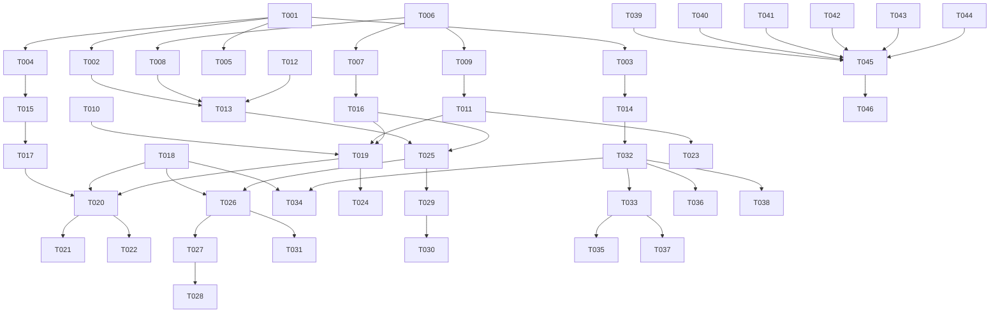

# Tasks: 本地内容规模与检索能力升级

**Input**: `spec/rss-core-upgrade/spec.md`, `spec/rss-core-upgrade/plan.md`
**Prerequisites**: spec.md（必需）、plan.md（必需）

**Tests**: 未要求 TDD；仅在 Polish 阶段为纯逻辑（查询解析、保留候选、持久化迁移）补关键 ohosTest 用例。

**Organization**: 按用户故事分组：US1 = 历史不再被删除，US2 = 全局全文检索，US3 = 单源设置。

## Format: `[ID] [P?] [Story] Description`

- **[P]**: 不同文件、无未完成依赖，可并行
- **[Story]**: 仅用户故事阶段任务带 `[USx]`
- 所有路径均为工程内绝对相对路径

## Path Conventions

- 源码：`entry/src/main/ets/`
- 资源：`entry/src/main/resources/{base,zh_CN}/element/`
- 测试：`entry/src/ohosTest/ets/test/`

---

## Phase 1: Setup (Shared Infrastructure)

**Purpose**: 常量、模型、路由、文案等共享骨架

- [X] T001 新增保留策略/三态/全文策略语义常量与选项表，并补充偏好 key、路由常量、FTS/回收站常量：`entry/src/main/ets/common/constants/SettingsConstants.ets`、`entry/src/main/ets/common/constants/SettingsOptions.ets`、`entry/src/main/ets/common/constants/PreferencesConstants.ets`、`entry/src/main/ets/common/constants/RssConstants.ets`、`entry/src/main/ets/common/constants/RouterConstants.ets`
- [X] T002 [P] 新增搜索领域模型 `entry/src/main/ets/model/Search.ets`（SearchQuery / SearchHit / SearchPage / StorageStats / RetentionCandidate）
- [X] T003 [P] 扩展 `FeedSource`（enabled / fetchIntervalMinutes / fullTextMode / retentionDays / notify / markReadOnScroll / failureCount）与 `EffectiveFeedSettings`：`entry/src/main/ets/model/Feed.ets`
- [X] T004 [P] 扩展全局设置 `retentionMode` / `retentionDays`：`entry/src/main/ets/model/AppSettings.ets`
- [X] T005 新增中英文文案（search_* / storage_* / feed_settings_* / retention_* / health_*）：`entry/src/main/resources/base/element/string.json`、`entry/src/main/resources/zh_CN/element/string.json`

---

## Phase 2: Foundational (Blocking Prerequisites)

**Purpose**: 数据层与编排层改造，所有用户故事都依赖

**⚠️ CRITICAL**: 本阶段完成前不要开始用户故事任务

- [X] T006 重写 `ArticleStore.open()` 为版本化迁移（`RdbStore.version` v1→v2：建索引 + `articles_trash` + `articles_fts`），保留旧列兼容与失败降级：`entry/src/main/ets/service/ArticleStore.ets`
- [X] T007 实现轻量列表读取与按需正文 `loadForList()` / `loadBody(id)`，替换 `loadRecent()` 的全量重列查询：`entry/src/main/ets/service/ArticleStore.ets`
- [X] T008 实现 FTS 同步（insert / update plain_text / delete）与 `isFtsReady()`、`search()`、`rebuildSearchIndex()`（含 CJK LIKE 兜底）：`entry/src/main/ets/service/ArticleStore.ets`
- [X] T009 实现回收站 `archiveToTrash()` / `restoreTrash()` / `purgeTrash()` / `trashCount()`，并保证 FTS 行同步：`entry/src/main/ets/service/ArticleStore.ets`
- [X] T010 实现存储统计 `storageStats()`（总条数 / 文本占用 / 按源占用 / 可清理条数）：`entry/src/main/ets/service/ArticleStore.ets`
- [X] T011 实现 `RetentionService`（effectiveRetentionDays / estimate / runIfDue / runNow / restoreAll / purgeExpired）：`entry/src/main/ets/service/RetentionService.ets`
- [X] T012 [P] 实现 `SearchQueryParser`（from/is/after/before/引号短语 / FTS token 转义 / 空查询判断）：`entry/src/main/ets/service/SearchQueryParser.ets`
- [X] T013 实现 `SearchStore`（FTS 优先 + LIKE 降级 + 分页 + 搜索历史读写）：`entry/src/main/ets/service/SearchStore.ets`
- [X] T014 扩展 `FeedStore` 记录结构，持久化单源设置与健康状态，旧数据回退默认值：`entry/src/main/ets/service/FeedStore.ets`
- [X] T015 扩展 `SettingsStore` 读写保留策略，并做归一：`entry/src/main/ets/service/SettingsStore.ets`
- [X] T016 改造 `FeedViewModel` 基础能力：轻量加载、`ensureBodyLoaded()`、`openArticleById()` 按库兜底、`refreshAll(force)` / `refreshCurrentFeed(force)` 签名、初始化时清理过期回收站：`entry/src/main/ets/viewmodel/FeedViewModel.ets`
- [X] T017 [P] 在 `SettingsViewModel` 增加保留策略 setter 与即时重算：`entry/src/main/ets/viewmodel/SettingsViewModel.ets`
- [X] T018 在 `pages/Index.ets` 注册 3 个新路由（search / storage / feedSettings）并补充对应 NavDestination 占位：`entry/src/main/ets/pages/Index.ets`

**Checkpoint**: 数据层可迁移、可检索、可清理；可开始用户故事

---

## Phase 3: User Story 1 - 历史文章不再被自动删除 (Priority: P1) 🎯 MVP

**Goal**: 默认全量保留，可按天数/仅未读与收藏清理，清理可预览、可撤销，并提供存储管理页

**Independent Test**: 构造 5000+ 篇文章，执行清理后早期文章仍可读；清理后 7 天内可恢复；收藏/稍后读/有高亮的文章从未被删

- [X] T019 [US1] 实现 `StorageViewModel`（统计加载、可清理估算、清理执行、恢复、索引重建进度）：`entry/src/main/ets/viewmodel/StorageViewModel.ets`
- [X] T020 [US1] 新增「存储与保留」页（保留模式/天数、总占用、按源占用、可清理条数、立即清理二次确认、回收站与恢复、重建索引）：`entry/src/main/ets/views/StorageView.ets`
- [X] T021 [US1] 在设置页增加「存储与保留」入口：`entry/src/main/ets/views/SettingsTabView.ets`
- [X] T022 [US1] 在抓取提交后与启动时异步触发保留清理（6 小时节流，不阻塞 `publish`）：`entry/src/main/ets/viewmodel/FeedViewModel.ets`
- [X] T023 [US1] 后台任务结束后执行保留清理与回收站过期清理：`entry/src/main/ets/workscheduler/RssWorkScheduler.ets`
- [X] T024 [US1] 清理/恢复完成后刷新列表与存储页统计，并处理「当前文章被保护」边界：`entry/src/main/ets/viewmodel/StorageViewModel.ets`

**Checkpoint**: US1 可独立验收（历史保留 + 清理 + 撤销）

---

## Phase 4: User Story 2 - 在全部历史中全文检索 (Priority: P1)

**Goal**: 独立搜索页，支持语法、分页、历史、命中片段与正文定位

**Independent Test**: 导入 1 万篇后搜索仅出现在正文的中文关键词，300ms 内出首屏结果，点击可定位正文

- [X] T025 [US2] 实现 `SearchViewModel`（查询、筛选、分页、历史、错误态、打开命中）：`entry/src/main/ets/viewmodel/SearchViewModel.ets`
- [X] T026 [US2] 新增搜索页（输入、历史 chips、状态筛选、结果列表、触底续页、空态与清空历史）：`entry/src/main/ets/views/SearchView.ets`
- [X] T027 [US2] 首页搜索入口改为压入搜索页，移除内联关键词输入与空态文案分支：`entry/src/main/ets/views/HomeTabView.ets`
- [X] T028 [US2] 移除 `FeedViewModel` 的内存关键词过滤（`matchesKeyword` / `setKeyword` 相关路径），避免两套搜索并存：`entry/src/main/ets/viewmodel/FeedViewModel.ets`
- [X] T029 [US2] 实现 `openSearchHit()`：按 id 补全正文、写入 `pendingSearchTerm`、打开详情：`entry/src/main/ets/viewmodel/FeedViewModel.ets`
- [X] T030 [US2] 详情页消费 `pendingSearchTerm`，在正文加载完成后复用 `ReaderFind` 注入并定位首个命中、展开查找条：`entry/src/main/ets/views/ArticleDetailView.ets`
- [X] T031 [US2] 搜索结果片段高亮与来源/时间展示（命中词强调、摘要片段裁切）：`entry/src/main/ets/views/SearchView.ets`

**Checkpoint**: US2 可独立验收（搜索、语法、历史、定位）

---

## Phase 5: User Story 3 - 按订阅源控制抓取与保留 (Priority: P2)

**Goal**: 单源覆盖全局策略，停用源不抓取不通知，源健康状态可见

**Independent Test**: 关闭某源抓取并设 30 天保留，验证不产生新文章/通知、历史按策略清理、其他源不受影响

- [X] T032 [US3] 实现 `effectiveSettings()` / `markReadOnScrollEffective()` / `updateFeedSettings()` / `retryFeed()` 与设置归一：`entry/src/main/ets/viewmodel/FeedViewModel.ets`
- [X] T033 [US3] 抓取编排按「启用 + 源级间隔到期」过滤，`force=true` 可绕过到期但不绕过停用；成功后清零失败计数、记录成功时间，失败累加：`entry/src/main/ets/viewmodel/FeedViewModel.ets`
- [X] T034 [US3] 新增单源设置页（启用/间隔/全文策略/保留天数/通知/滚动已读/健康信息与重试）：`entry/src/main/ets/views/FeedSettingsView.ets`
- [X] T035 [US3] 订阅源行展示健康状态（停用标识、连续失败、最后成功时间）并在溢出菜单增加「源设置」入口：`entry/src/main/ets/views/SubscriptionsView.ets`
- [X] T036 [US3] 阅读正文按源全文策略执行（auto/always/never），并接入 `ArticleContentService`：`entry/src/main/ets/service/ArticleContentService.ets`、`entry/src/main/ets/viewmodel/FeedViewModel.ets`
- [X] T037 [US3] 后台任务按源「启用 + 到期」抓取，并按源通知设置过滤通知内容：`entry/src/main/ets/workscheduler/RssWorkScheduler.ets`
- [X] T038 [US3] 详情页接入「滚动已读」：生效为 on 时打开不立即已读，进度 ≥0.8 或触底才标记已读：`entry/src/main/ets/views/ArticleDetailView.ets`、`entry/src/main/ets/viewmodel/FeedViewModel.ets`

**Checkpoint**: US3 可独立验收（单源设置、健康状态、通知过滤）

---

## Phase 6: Polish & Cross-Cutting Concerns

- [X] T039 [P] 更新 `README.md` 功能清单与 `TODO.md` 中 P0-3 / P1-1 / P1-3 勾选：`README.md`、`TODO.md`
- [X] T040 [P] 新增 `SearchQueryParser` 单元测试（语法、空查询、特殊字符、CJK）：`entry/src/ohosTest/ets/test/SearchQueryParser.test.ets` 并在 `entry/src/ohosTest/ets/test/List.test.ets` 聚合
- [X] T041 [P] 新增保留候选与保护条件单元测试（收藏/稍后读/高亮/当前文章不被清理）：`entry/src/ohosTest/ets/test/Retention.test.ets`
- [X] T042 [P] 新增 `FeedStore` 旧记录兼容与脏值归一测试：`entry/src/ohosTest/ets/test/FeedStore.test.ets`
- [X] T043 全量 `arkts_check` 并修复新增违规（重点：可空收窄、禁止 any、枚举归一）：`entry/src/main/ets/`
- [X] T044 纯 V2 自查（无 V1 装饰器 / 无 HdsListItem），确认输出为空：`entry/src/main/ets/`、`AppScope/`

---

## Phase 7: Verification

<!-- verification_scope: build-only -->

**Purpose**: 构建与部署验证

- [X] T045 构建工程并修复编译错误（`build_project`，增量构建；循环修复直至成功）
- [X] T046 部署到设备/模拟器验证可启动（`start_app`）

---

## Dependencies & Execution Order

### Phase Dependencies

- **Setup (Phase 1)**: 无依赖，可立即开始
- **Foundational (Phase 2)**: 依赖 Setup，阻塞所有用户故事
- **User Stories (Phase 3–5)**: 均依赖 Foundational
  - US1 → US2 → US3 按优先级顺序可执行；视图层可在接口稳定后并行
- **Polish (Phase 6)**: 依赖三个用户故事完成
- **Verification (Phase 7)**: 依赖 Polish 完成（build-only）

### User Story Dependencies

- **US1 (P1)**: Foundational 后即可开始，不依赖其他故事
- **US2 (P1)**: Foundational 后即可开始；与 US1 共用 `FeedViewModel`，需先合并方法签名再改
- **US3 (P2)**: Foundational 后即可开始；`FeedViewModel` 与 US2 有文件重叠，必须串行合并

### Within Each User Story

- Model / 常量 → Service → ViewModel → View → 路由
- 同一文件的任务必须串行
- 每个故事完成后再进入下一个优先级



### Parallel Opportunities

| Phase | Tasks | Required Files | Execution Notes |
| --- | --- | --- | --- |
| Setup | T002, T003, T004, T005 | `model/Search.ets`、`model/Feed.ets`、`model/AppSettings.ets`、`resources/*/string.json` | 四个不同文件，可并行；T001 先完成 |
| Foundational | T012, T017 | `service/SearchQueryParser.ets`、`viewmodel/SettingsViewModel.ets` | 新增/独立文件，可并行 |
| US1 | T020, T023 | `views/StorageView.ets`、`workscheduler/RssWorkScheduler.ets` | 无文件冲突 |
| US3 | T034, T035, T036, T037 | `views/FeedSettingsView.ets`、`views/SubscriptionsView.ets`、`service/ArticleContentService.ets`、`workscheduler/RssWorkScheduler.ets` | T034/T035 可并行；T036/T037 可并行；T038 最后 |
| Polish | T039, T040, T041, T042 | `README.md`、`TODO.md`、`entry/src/ohosTest/ets/test/*` | 全部可并行 |

## Parallel Example

```text
# Setup 并行
Task: "T002 新增 Search 模型"
Task: "T003 扩展 FeedSource"
Task: "T004 扩展 AppSettings"
Task: "T005 新增中英文文案"

# US3 视图并行
Task: "T034 新增单源设置页"
Task: "T035 订阅页健康状态与入口"
```

## Implementation Strategy

### MVP First（US1）

1. 完成 Setup + Foundational
2. 完成 US1（历史保留 + 清理 + 撤销）
3. 独立验证：5000+ 篇不丢历史、保护条件生效、7 天可恢复
4. 部署演示

### Incremental Delivery

1. Foundation → US1（数据安全）
2. US2（检索）→ 独立验证 1 万篇搜索
3. US3（单源控制）→ 独立验证停用源零抓取
4. Polish → 构建 + 部署验证

## Notes

- 总任务数 46（T001–T046）：US1 6 个、US2 7 个、US3 7 个、Setup 5 个、Foundational 13 个、Polish 6 个、Verification 2 个
- 建议 MVP 范围：Setup + Foundational + US1
- 独立测试口径：US1「5000+ 篇不丢 + 保护 + 恢复」；US2「中文正文命中 + 语法 + 定位」；US3「停用源零新增 + 单源保留生效」
- 验证范围：build-only（构建 + 部署，不做逐条 UI 验证）
- `[P]` 表示不同文件且无未完成依赖
- 同一文件（尤其 `ArticleStore.ets`、`FeedViewModel.ets`）的任务必须顺序执行
