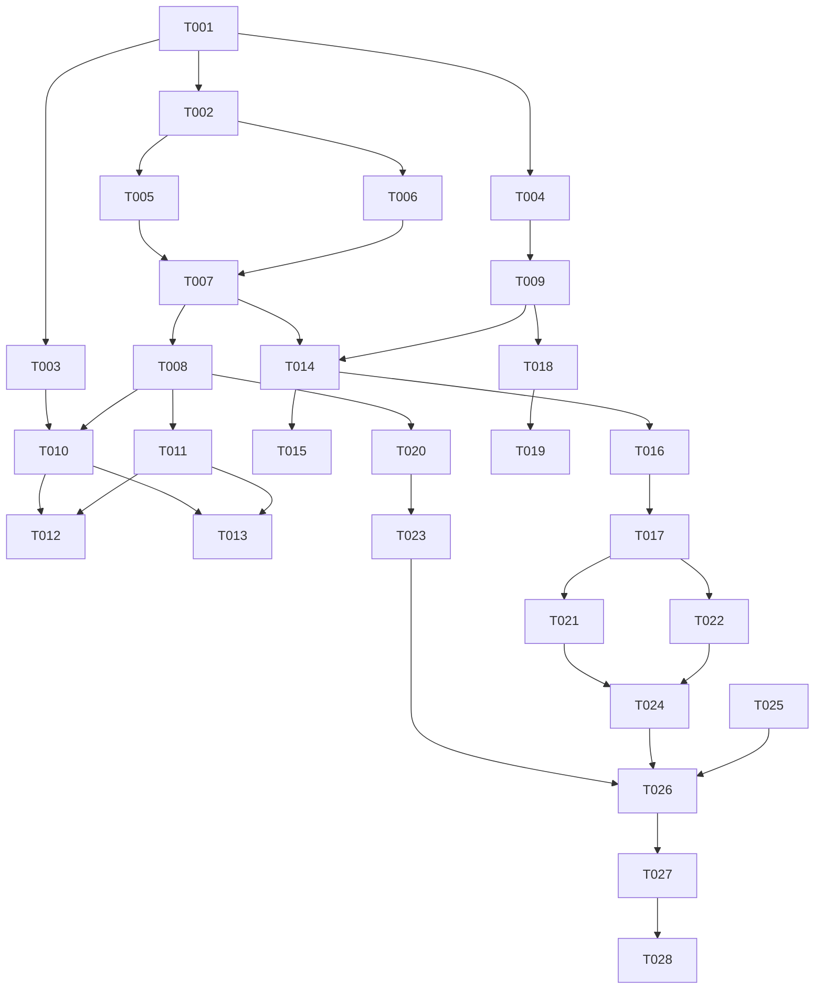

# Tasks: 本地规则引擎

**Input**: `spec/rules-engine/spec.md`, `spec/rules-engine/plan.md`
**Prerequisites**: spec.md（必需）、plan.md（必需）

**Tests**: 未要求 TDD；Polish 阶段补匹配与优先级合并的纯逻辑单测。

**Organization**: US1 = 规则管理；US2 = 新文章自动执行；US3 = 隐藏与可观测。

## Format: `[ID] [P?] [Story] Description`

- **[P]**: 不同文件、无未完成依赖
- **[Story]**: 仅用户故事阶段任务带 `[USx]`
- 路径相对于工程根目录

## Path Conventions

- 源码：`entry/src/main/ets/`
- 资源：`entry/src/main/resources/{base,zh_CN}/element/`
- 测试：`entry/src/ohosTest/ets/test/`

---

## Phase 1: Setup (Shared Infrastructure)

**Purpose**: 常量、模型、文案

- [X] T001 新增规则常量与 schema 版本（`SCHEMA_VERSION` 5→6、`TABLE_RULES`、规则/关键词上限、`ArticleFilter.HIDDEN` 与归一）及三条路由：`entry/src/main/ets/common/constants/RssConstants.ets`、`entry/src/main/ets/common/constants/RouterConstants.ets`
- [X] T002 [P] 新增 `model/Rule.ets`（Rule / RuleDraft / RuleTestResult / RuleAction / RuleField），并给 `Article` 增加 `hidden`：`entry/src/main/ets/model/Rule.ets`、`entry/src/main/ets/model/Feed.ets`
- [X] T003 [P] 新增中英文案（`rule_*` / `hidden_*`）：`entry/src/main/resources/base/element/string.json`、`entry/src/main/resources/zh_CN/element/string.json`

---

## Phase 2: Foundational (Blocking Prerequisites)

**Purpose**: 数据层、引擎与服务

**⚠️ CRITICAL**: 本阶段完成前不要开始用户故事

- [X] T004 `ArticleStore` v6：`articles.is_hidden` 加列 + `rules` 表 + `idx_rules_priority`；LIST/BODY 列含 `is_hidden` 并回填 `article.hidden`；`setHidden` / `setHiddenMany`；最新版本 IF NOT EXISTS 自愈：`entry/src/main/ets/service/ArticleStore.ets`
- [X] T005 [P] 实现 `RuleEngine` 纯函数（matches / plan / normalizeKeywords / validateDraft，正文截断 20K）：`entry/src/main/ets/service/RuleEngine.ets`
- [X] T006 实现 `RuleStore`（list / create / update / remove / setEnabled / move / recordHits / sampleArticles）：`entry/src/main/ets/service/RuleStore.ets`
- [X] T007 实现 `RuleService`（applyToNew：加载规则 → plan → 批量动作 → 统计 → 内存态回写 → 远程入队；testRun 只读）：`entry/src/main/ets/service/RuleService.ets`
- [X] T008 [P] 实现 `RuleViewModel`（列表/编辑/试运行/隐藏列表/启停/排序）：`entry/src/main/ets/viewmodel/RuleViewModel.ets`
- [X] T009 `FeedViewModel` 隐藏过滤：`ArticleFilter.HIDDEN` 只保留隐藏文章；其它筛选排除隐藏；未读数/分组未读/归档计数/单源列表均排除隐藏；新增 `hiddenCount()` / `setHidden()`：`entry/src/main/ets/viewmodel/FeedViewModel.ets`

**Checkpoint**: 规则可存储、可匹配、可应用

---

## Phase 3: User Story 1 - 创建与管理规则 (Priority: P1) 🎯 MVP

**Goal**: 规则列表、编辑、启停、排序、试运行、删除

**Independent Test**: 新建规则并保存；启停后行为变化；上下移持久化；试运行计数正确且零写入

- [X] T010 [US1] 新增规则页 `RulesView`（启停开关、优先级上下移、命中次数/最后命中、试运行、编辑/删除确认）：`entry/src/main/ets/views/RulesView.ets`
- [X] T011 [US1] 新增规则编辑页 `RuleEditView`（名称、关键词、字段多选、来源范围、动作多选、标签多选、保存校验）：`entry/src/main/ets/views/RuleEditView.ets`
- [X] T012 [US1] 订阅页新增「规则（N）」入口，并注册 `PAGE_RULES` / `PAGE_RULE_EDIT`：`entry/src/main/ets/views/SubscriptionsView.ets`、`entry/src/main/ets/pages/Index.ets`
- [X] T013 [US1] 编辑/试运行/删除接线与错误提示（空名称、空关键词、超上限）：`entry/src/main/ets/viewmodel/RuleViewModel.ets`、`entry/src/main/ets/views/RuleEditView.ets`

**Checkpoint**: US1 可独立验收（管理 + 试运行）

---

## Phase 4: User Story 2 - 新文章自动执行规则 (Priority: P1)

**Goal**: 本地抓取与远端同步的新文章都自动执行规则

**Independent Test**: 构造含关键词的新文章，入库后自动打标/已读/收藏/隐藏；重复同步无重复标签

- [X] T014 [US2] `commitFresh` 接入：`insertNew` → `ruleService.applyToNew(fresh)` → `reloadFromStore` → `publish`：`entry/src/main/ets/viewmodel/FeedViewModel.ets`
- [X] T015 [US2] 远端同步接入：`insertRemote` 成功后调用 `applyToNew` 并刷新列表：`entry/src/main/ets/service/remote/RemoteSyncService.ets`
- [X] T016 [US2] 幂等与多规则合并：同篇多规则动作累积、标签 `INSERT OR IGNORE`、统计按实际命中累加、内存态（read/starred/hidden）同步更新：`entry/src/main/ets/service/RuleService.ets`
- [X] T017 [US2] 失败降级：规则加载/匹配/动作异常只记日志，不影响文章入库与列表刷新：`entry/src/main/ets/service/RuleService.ets`、`entry/src/main/ets/viewmodel/FeedViewModel.ets`

**Checkpoint**: US2 可独立验收（本地 + 远端 + 幂等）

---

## Phase 5: User Story 3 - 隐藏与可观测 (Priority: P2)

**Goal**: 已隐藏列表可打开/取消隐藏；规则统计与试运行结果可见

**Independent Test**: 规则隐藏文章后主列表消失、已隐藏列表可见；取消隐藏后恢复；统计与试运行显示正确

- [X] T018 [US3] 新增「已隐藏」页 `HiddenArticlesView`（轻量列 + 取消隐藏），注册 `PAGE_HIDDEN`：`entry/src/main/ets/views/HiddenArticlesView.ets`、`entry/src/main/ets/pages/Index.ets`
- [X] T019 [US3] 取消隐藏后主列表与未读数恢复，规则页「已隐藏（N）」计数刷新：`entry/src/main/ets/viewmodel/RuleViewModel.ets`、`entry/src/main/ets/viewmodel/FeedViewModel.ets`
- [X] T020 [US3] 规则页展示累计命中/最后命中与试运行结果（最近 500 篇命中数）：`entry/src/main/ets/views/RulesView.ets`、`entry/src/main/ets/viewmodel/RuleViewModel.ets`

**Checkpoint**: 三个故事均可独立工作

---

## Phase 6: Polish & Cross-Cutting Concerns

- [X] T021 [P] 新增 `RuleEngine.test.ets`（字段范围、来源范围、大小写、多关键词 AND、正文截断、动作计划）：`entry/src/ohosTest/ets/test/RuleEngine.test.ets` 并在 `List.test.ets` 聚合
- [X] T022 [P] 新增 `RuleOrder.test.ets`（优先级排序、多规则动作合并、幂等计划）：`entry/src/ohosTest/ets/test/RuleOrder.test.ets` 并在 `List.test.ets` 聚合
- [X] T023 [P] 更新 `README.md` 与 `TODO.md` 进度：`README.md`、`TODO.md`
- [X] T024 全量 `arkts_check` 并修复新增违规：`entry/src/main/ets/`
- [X] T025 纯 V2 自查（无 V1 装饰器 / 无 HdsListItem）：`entry/src/main/ets/`、`AppScope/`

---

## Phase 7: Verification

<!-- verification_scope: build+ui -->

**Purpose**: 构建、部署与逐条用户故事 UI 验证

- [X] T026 构建工程并修复编译错误（`build_project`，增量构建，循环修复直至成功）
- [X] T027 部署到设备并确认启动成功（`start_app`）
- [X] T028 按用户故事执行 UI 验证（每条故事最多 3 次验证尝试）：`verify_ui`

---

## Dependencies & Execution Order

### Phase Dependencies

- **Setup (Phase 1)**: 无依赖
- **Foundational (Phase 2)**: 依赖 Setup，阻塞所有用户故事
- **US1 (Phase 3)**: Foundational 后可开始
- **US2 (Phase 4)**: 依赖 US1 的规则数据与 RuleService
- **US3 (Phase 5)**: 依赖 US2 的隐藏执行
- **Polish (Phase 6)**: 依赖三个故事
- **Verification (Phase 7)**: 依赖 Polish（build+ui）

### User Story Dependencies

- **US1 (P1)**: 可独立验收
- **US2 (P1)**: 依赖 US1
- **US3 (P2)**: 依赖 US2

### Within Each User Story

- Model → Engine/Store → Service → ViewModel → View → 路由
- `ArticleStore` / `FeedViewModel` / `Index` 为共享文件，相关任务必须串行
- 每个故事完成后再进入下一个



### Parallel Opportunities

| Phase | Tasks | Required Files | Execution Notes |
| --- | --- | --- | --- |
| Setup | T002, T003 | `model/Rule.ets`、`resources/*` | 不同文件，可并行 |
| Foundational | T005, T008 | `service/RuleEngine.ets`、`viewmodel/RuleViewModel.ets` | 与 Store/Service 无文件冲突 |
| US1 | T010, T011 | `views/RulesView.ets`、`views/RuleEditView.ets` | 不同文件，可并行 |
| Polish | T021, T022, T023 | `ohosTest/*`、`README.md`、`TODO.md` | 全部可并行 |

## Parallel Example

```text
# Setup 并行
Task: "T002 新增 Rule 模型与 Article.hidden"
Task: "T003 新增中英文案"

# US1 并行
Task: "T010 规则列表页"
Task: "T011 规则编辑页"
```

## Implementation Strategy

### MVP First（US1）

1. 完成 Setup + Foundational
2. 完成 US1（规则 CRUD + 试运行）
3. 独立验证：保存、启停、排序、试运行
4. 再进入 US2/US3

### Incremental Delivery

1. US1 → 规则可配置
2. US2 → 新文章自动执行
3. US3 → 隐藏可找回 + 统计可见
4. Polish → 单测与静态检查
5. Verification → 构建 + 部署 + UI

## Notes

- 总任务数 28（T001–T028）：Setup 3、Foundational 6、US1 4、US2 4、US3 3、Polish 5、Verification 3
- 建议 MVP：Setup + Foundational + US1
- 验证范围：build+ui
- UI 验证用例（每条故事一条）：
  - User Story 1: 新建规则「标题含 AI → 打标签 AI + 标记已读」，保存后列表可见并可试运行 预期：试运行显示命中数且文章状态未变
  - User Story 2: 触发一次抓取/构造含 AI 的新文章入库 预期：文章自动带 AI 标签且为已读，标签计数增加
  - User Story 3: 新建「标题含 AI → 隐藏」规则并让文章命中 预期：主列表不显示，规则页「已隐藏（1）」可打开并取消隐藏后恢复
- `ArticleStore.ets` / `FeedViewModel.ets` / `Index.ets` 为共享文件，相关任务必须串行
- 规则执行失败只记日志，不阻断入库
