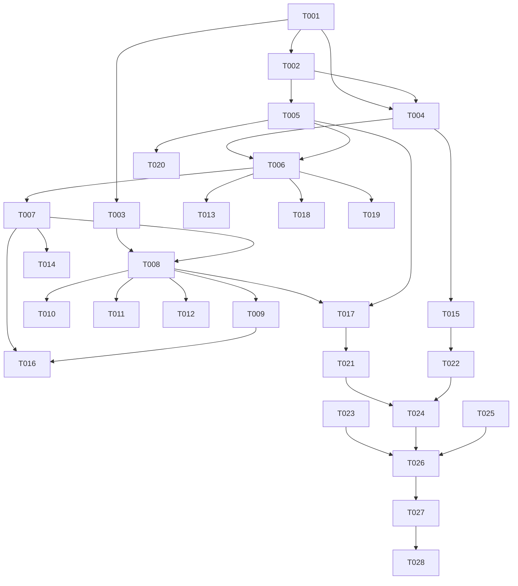

# Tasks: 分享目标扩展

**Input**: `spec/share-targets/spec.md`, `spec/share-targets/plan.md`
**Prerequisites**: spec.md（必需）、plan.md（必需）

**Tests**: 未要求 TDD；Polish 阶段补目标 URL 构造与模板渲染的纯逻辑单测。

**Organization**: US1 = 统一面板；US2 = 内置目标；US3 = 模板与高亮导出。

## Format: `[ID] [P?] [Story] Description`

- **[P]**: 不同文件、无未完成依赖
- **[Story]**: 仅用户故事阶段任务带 `[USx]`
- 路径相对于工程根目录

## Path Conventions

- 源码：`entry/src/main/ets/`
- 资源：`entry/src/main/resources/{base,zh_CN}/element/`
- 测试：`entry/src/ohosTest/ets/test/`

---

## Phase 1: Setup (Shared Infrastructure)

**Purpose**: 常量、模型、文案

- [X] T001 新增分享常量与路由（模板/正文上限、`KEY_SHARE_TEMPLATES`、`PAGE_SHARE_SETTINGS`）：`entry/src/main/ets/common/constants/CommonConstants.ets`、`entry/src/main/ets/common/constants/PreferencesConstants.ets`、`entry/src/main/ets/common/constants/RouterConstants.ets`
- [X] T002 [P] 新增 `model/Share.ets`（ShareContext / ShareTarget / ShareTemplate / ShareResult / ShareKind）：`entry/src/main/ets/model/Share.ets`
- [X] T003 [P] 新增中英文案（`share_*` / `tpl_*`）：`entry/src/main/resources/base/element/string.json`、`entry/src/main/resources/zh_CN/element/string.json`

---

## Phase 2: Foundational (Blocking Prerequisites)

**Purpose**: 目标、模板、服务、面板与管理页

**⚠️ CRITICAL**: 本阶段完成前不要开始用户故事

- [X] T004 [P] 实现 `ShareTargets` 纯函数（targets / buildUri / encode；Pocket/Instapaper/Flomo/mailto）：`entry/src/main/ets/service/ShareTargets.ets`
- [X] T005 实现 `ShareTemplates`（render / validate / list / saveAll / create / update / remove / move；默认模板）：`entry/src/main/ets/service/ShareTemplates.ets`
- [X] T006 实现 `ShareService`（articleContext / highlightContext / execute / exportArticleHighlights / exportAllHighlights；失败回退复制）：`entry/src/main/ets/service/ShareService.ets`
- [X] T007 [P] 实现 `ShareViewModel`（context / templates / busy / open / close / targets / runTarget / runTemplate / exportThisArticle）：`entry/src/main/ets/viewmodel/ShareViewModel.ets`
- [X] T008 新增统一分享面板 `ShareSheet`（动作 / 外部目标 / 模板 / 高亮导出，分组 + 置灰原因）：`entry/src/main/ets/views/ShareSheet.ets`
- [X] T009 新增分享与模板管理页 `ShareSettingsView` + 路由注册：`entry/src/main/ets/views/ShareSettingsView.ets`、`entry/src/main/ets/pages/Index.ets`

**Checkpoint**: 面板可打开、目标/模板可执行

---

## Phase 3: User Story 1 - 统一分享面板 (Priority: P1) 🎯 MVP

**Goal**: 三处入口复用同一面板

**Independent Test**: 详情页、列表左滑、高亮页均能打开面板且上下文正确

- [X] T010 [US1] 详情页底栏/菜单新增「分享」入口并打开面板：`entry/src/main/ets/views/ArticleDetailView.ets`
- [X] T011 [US1] 列表左滑新增「分享」动作：`entry/src/main/ets/views/HomeTabView.ets`
- [X] T012 [US1] 高亮页单条高亮新增分享入口（上下文为引文 + 备注 + 文章链接）：`entry/src/main/ets/views/HighlightsView.ets`

**Checkpoint**: US1 可独立验收（三入口）

---

## Phase 4: User Story 2 - 内置目标投递 (Priority: P1)

**Goal**: 目标正确拉起、失败回退、缺 URL 禁用

**Independent Test**: 点击目标拉起对应 App；未安装时提示并复制链接

- [X] T013 [US2] 目标执行与降级：`startAbility` 失败 → 提示 + 自动复制链接；剪贴板结果统一 Toast：`entry/src/main/ets/service/ShareService.ets`、`entry/src/main/ets/views/ShareSheet.ets`
- [X] T014 [US2] 可用性判定：缺 URL 的目标置灰并说明；系统分享不可用时的提示：`entry/src/main/ets/viewmodel/ShareViewModel.ets`、`entry/src/main/ets/views/ShareSheet.ets`
- [X] T015 [US2] 邮件预填（subject/body 编码，含标题、链接、摘要截断）：`entry/src/main/ets/service/ShareTargets.ets`、`entry/src/main/ets/service/ShareService.ets`

**Checkpoint**: US2 可独立验收（目标 / 降级 / 禁用）

---

## Phase 5: User Story 3 - 自定义模板与高亮导出 (Priority: P2)

**Goal**: 多模板管理、面板使用、单篇/全部高亮 Markdown

**Independent Test**: 新建排序模板并在面板复制；单篇与全部高亮导出 Markdown 内容完整

- [X] T016 [US3] 模板管理接线：列表、新建/编辑、删除确认、上下移、校验提示：`entry/src/main/ets/views/ShareSettingsView.ets`、`entry/src/main/ets/viewmodel/ShareViewModel.ets`
- [X] T017 [US3] 面板模板区：按排序展示，支持「复制」与「系统分享」：`entry/src/main/ets/views/ShareSheet.ets`、`entry/src/main/ets/service/ShareTemplates.ets`
- [X] T018 [US3] 单篇高亮导出：读取该篇高亮 → `toMarkdown` → 系统分享；无高亮禁用：`entry/src/main/ets/service/ShareService.ets`
- [X] T019 [US3] 全部高亮 Markdown 接入面板/设置页（保留现有 JSON）：`entry/src/main/ets/service/ShareService.ets`、`entry/src/main/ets/views/ShareSheet.ets`
- [X] T020 [US3] 占位符渲染边界：空字段、重复占位符、未知占位符原样保留、Markdown 转义：`entry/src/main/ets/service/ShareTemplates.ets`

**Checkpoint**: 三个故事均可独立工作

---

## Phase 6: Polish & Cross-Cutting Concerns

- [X] T021 [P] 新增 `ShareTemplates.test.ets`（占位符、未知 token、重复 token、空字段、校验、排序/默认模板）：`entry/src/ohosTest/ets/test/ShareTemplates.test.ets` 并在 `List.test.ets` 聚合
- [X] T022 [P] 新增 `ShareTargets.test.ets`（URL 编码、mailto subject/body、缺 URL 返回空）：`entry/src/ohosTest/ets/test/ShareTargets.test.ets` 并在 `List.test.ets` 聚合
- [X] T023 [P] 更新 `README.md` 与 `TODO.md`（P1-6 勾选）：`README.md`、`TODO.md`
- [X] T024 全量 `arkts_check` 并修复新增违规：`entry/src/main/ets/`
- [X] T025 纯 V2 自查（无 V1 装饰器 / 无 HdsListItem）：`entry/src/main/ets/`、`AppScope/`

---

## Phase 7: Verification

<!-- verification_scope: build+ui -->

**Purpose**: 构建、部署与逐条用户故事 UI 验证

- [X] T026 构建工程并修复编译错误（`build_project`，增量构建，循环修复直至成功）
- [X] T027 部署到设备并确认启动成功（`start_app`）
- [X] T028 按用户故事执行 UI 验证（每条故事最多 3 次验证尝试）：`verify_ui`

---

## Dependencies & Execution Order

### Phase Dependencies

- **Setup (Phase 1)**: 无依赖
- **Foundational (Phase 2)**: 依赖 Setup，阻塞所有用户故事
- **US1 (Phase 3)**: Foundational 后可开始
- **US2 (Phase 4)**: 依赖 US1 的面板
- **US3 (Phase 5)**: 依赖 US1/US2
- **Polish (Phase 6)**: 依赖三个故事
- **Verification (Phase 7)**: 依赖 Polish（build+ui）

### User Story Dependencies

- **US1 (P1)**: 可独立验收
- **US2 (P1)**: 依赖 US1
- **US3 (P2)**: 依赖 US1

### Within Each User Story

- Model → Targets/Templates → Service → ViewModel → View → 入口
- `ShareSheet` / `ShareService` / `Index` 为共享文件，相关任务必须串行
- 每个故事完成后再进入下一个



### Parallel Opportunities

| Phase | Tasks | Required Files | Execution Notes |
| --- | --- | --- | --- |
| Setup | T002, T003 | `model/Share.ets`、`resources/*` | 不同文件，可并行 |
| Foundational | T004, T005, T007 | `ShareTargets.ets`、`ShareTemplates.ets`、`ShareViewModel.ets` | 不同文件，可并行 |
| US1 | T010, T011, T012 | 三个 View | 不同文件，可并行；需 T008 面板就绪 |
| Polish | T021, T022, T023 | `ohosTest/*`、`README.md`、`TODO.md` | 全部可并行 |

## Parallel Example

```text
# Setup 并行
Task: "T002 新增 Share 模型"
Task: "T003 新增中英文案"

# US1 并行
Task: "T010 详情页分享入口"
Task: "T011 列表左滑分享"
Task: "T012 高亮页单条分享"
```

## Implementation Strategy

### MVP First（US1）

1. 完成 Setup + Foundational
2. 完成 US1（三入口 + 面板）
3. 独立验证：三处打开面板、上下文正确
4. 再进入 US2/US3

### Incremental Delivery

1. US1 → 统一面板
2. US2 → 目标投递与降级
3. US3 → 模板 + 高亮导出
4. Polish → 单测与静态检查
5. Verification → 构建 + 部署 + UI

## Notes

- 总任务数 28（T001–T028）：Setup 3、Foundational 6、US1 3、US2 3、US3 5、Polish 5、Verification 3
- 建议 MVP：Setup + Foundational + US1
- 验证范围：build+ui
- UI 验证用例（每条故事一条）：
  - User Story 1: 打开任意文章详情 → 点「分享」 预期：面板出现，包含系统分享/复制/浏览器/稍后读、四个外部目标、模板区
  - User Story 2: 在面板点「Flomo」（未安装时）或「复制链接」 预期：未安装提示并自动复制；复制链接 Toast 成功
  - User Story 3: 设置新建模板 `{title} — {url}` → 面板选择并复制 预期：剪贴板内容为「标题 — 链接」；有高亮的文章可导出本篇 Markdown
- 目标 App 是否安装无法在模拟器保证：未安装时走「提示 + 复制链接」即视为通过
- `ShareSheet` / `ShareService` / `Index` 为共享文件，相关任务必须串行


## 验证补记（2026-10-23，模拟器）

`build+ui`：构建 2 次（`enabled` 与基类属性冲突 → 改名 `rowEnabled` 后通过）；部署启动正常，无崩溃。

- US1 统一面板：PASS（四组内容齐全，单 bindSheet 分派正确）。
- US2 内置目标：PASS。修复真实缺陷：`startAbility` 对未安装 scheme 不抛错，导致「提示 + 自动复制」兜底不触发。
  已在 `module.json5` 声明 `querySchemes` 并用 `bundleManager.canOpenLink` 预判，未安装时直接复制并提示。
- US3 模板与导出：核心 PASS（模板创建、顺序、复制 Toast 成功）。两项未端到端取证：
  1. 剪贴板回读受 `ohos.permission.READ_PASTEBOARD` 受限权限阻断（既有能力限制，非本特性）；
  2. 高亮导出因验证脚本使用「高亮库」而非实际「标注」入口，未进入执行；代码路径为
     `listHighlights → toMarkdown → shareText`，与既有「导出全部」共用。

结论：功能层面 US1/US2 通过、US3 核心通过；严格按 `verify_ui` 口径记 FAIL（环境/脚本限制）。
