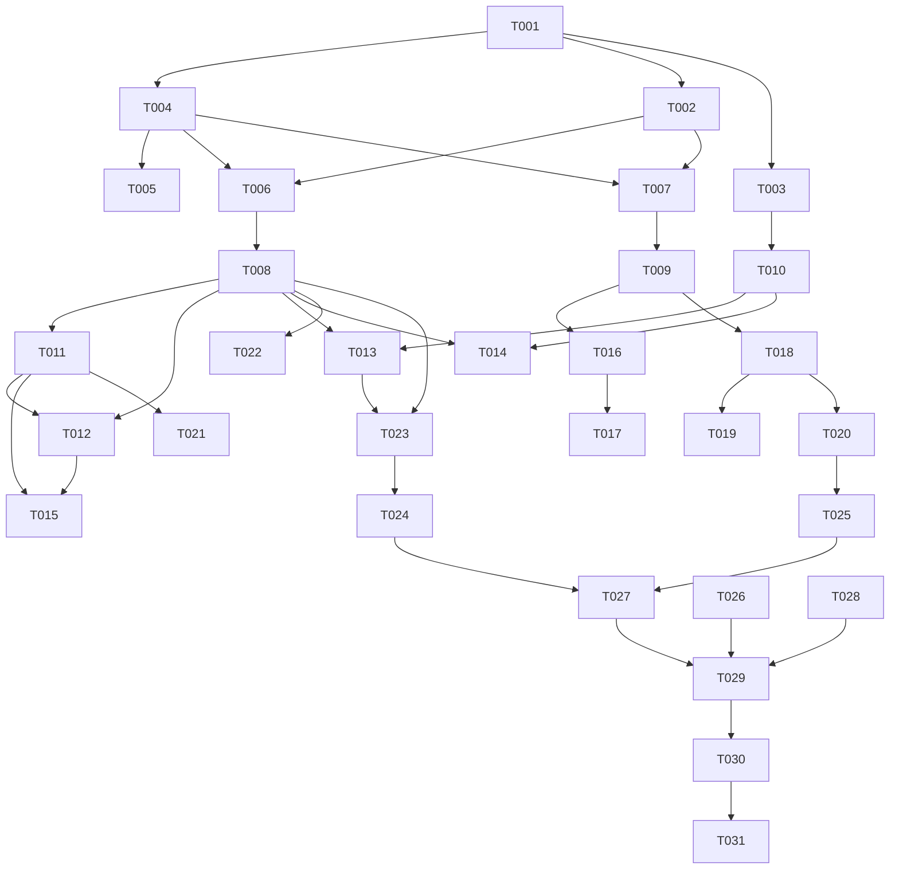

# Tasks: 标签与智能文件夹

**Input**: `spec/tags-rules/spec.md`, `spec/tags-rules/plan.md`
**Prerequisites**: spec.md（必需）、plan.md（必需）

**Tests**: 未要求 TDD；在 Polish 阶段为名称归一、去重、级联、查询校验补 ohosTest。

**Organization**: US1 = 标签；US2 = 智能文件夹；US3 = 入口与状态。

## Format: `[ID] [P?] [Story] Description`

- **[P]**: 不同文件、无未完成依赖
- **[Story]**: 仅用户故事阶段任务带 `[USx]`
- 路径相对于工程根目录

## Path Conventions

- 源码：`entry/src/main/ets/`
- 资源：`entry/src/main/resources/{base,zh_CN}/element/`
- 测试：`entry/src/ohosTest/ets/test/`

---

## Phase 1: Setup (Shared Infrastructure)

**Purpose**: 常量、模型、文案骨架

- [X] T001 新增标签/智能文件夹常量与 schema 版本（`SCHEMA_VERSION` 3→4、`TABLE_TAGS`、`TABLE_ARTICLE_TAGS`、`TABLE_SMART_FOLDERS`、上限常量）与三条路由：`entry/src/main/ets/common/constants/RssConstants.ets`、`entry/src/main/ets/common/constants/RouterConstants.ets`
- [X] T002 [P] 新增领域模型 `TagWithCount` / `SmartFolder`：`entry/src/main/ets/model/Tag.ets`
- [X] T003 [P] 新增中英文案（`tag_*` / `smart_folder_*`）：`entry/src/main/resources/base/element/string.json`、`entry/src/main/resources/zh_CN/element/string.json`

---

## Phase 2: Foundational (Blocking Prerequisites)

**Purpose**: 数据层与 ViewModel，所有用户故事依赖

**⚠️ CRITICAL**: 本阶段完成前不要开始用户故事

- [X] T004 迁移 v4：创建 `tags` / `article_tags` / `smart_folders` 与索引；已是最新版本的库也执行 `CREATE TABLE IF NOT EXISTS` 自愈；暴露 `getStore()`：`entry/src/main/ets/service/ArticleStore.ets`
- [X] T005 标签关联级联：`deleteMany` / `deleteByFeed` / `purgeTrash` 删除关联；`archiveToTrash` / `restoreTrash` 保留关联：`entry/src/main/ets/service/ArticleStore.ets`
- [X] T006 新增 `TagStore`（listTags / create / rename / remove / addToArticles / removeFromArticle / tagsOfArticle / articlesByTags / countByTags / countTags，含名称归一与上限保护）：`entry/src/main/ets/service/TagStore.ets`
- [X] T007 [P] 新增 `SmartFolderStore`（list / create / update / remove / move，含 `emptyQuery` 校验与上限）：`entry/src/main/ets/service/SmartFolderStore.ets`
- [X] T008 新增 `TagViewModel`（列表/计数/多选态/创建/重命名/删除/批量打标/标签文章加载）：`entry/src/main/ets/viewmodel/TagViewModel.ets`
- [X] T009 [P] 新增 `SmartFolderViewModel`（列表/CRUD/排序/打开时写入 pendingQuery）：`entry/src/main/ets/viewmodel/SmartFolderViewModel.ets`

**Checkpoint**: 数据层可读写，标签关联生命周期正确

---

## Phase 3: User Story 1 - 给文章打标签并按标签聚合 (Priority: P1) 🎯 MVP

**Goal**: 单篇/批量打标、标签页多选 AND、标签文章列表

**Independent Test**: 新建标签 → 详情页打标 → 标签页计数与文章正确；批量 20 篇打标成功；重命名/删除后关联正确

- [X] T010 [US1] 新增标签选择器 `TagPickerSheet`（已有标签复选 + 新建输入 + 确认回调）：`entry/src/main/ets/views/TagPickerSheet.ets`
- [X] T011 [US1] 新增标签页 `TagsView`（名称 + 计数 + 多选 AND + 行菜单重命名/删除 + 查看结果）：`entry/src/main/ets/views/TagsView.ets`
- [X] T012 [US1] 新增标签文章页 `TagArticlesView`（多标签 AND 结果、轻量列、点击打开详情）：`entry/src/main/ets/views/TagArticlesView.ets`
- [X] T013 [US1] 详情页展示文章标签 chips，并接入 `TagPickerSheet` 增删：`entry/src/main/ets/views/ArticleDetailView.ets`
- [X] T014 [US1] 首页多选工具条新增「标签」动作，打开 `TagPickerSheet` 批量打标：`entry/src/main/ets/views/HomeTabView.ets`
- [X] T015 [US1] 注册 `PAGE_TAGS` / `PAGE_TAG_ARTICLES` 路由与 NavDestination：`entry/src/main/ets/pages/Index.ets`

**Checkpoint**: US1 可独立验收（打标 + 聚合 + 批量）

---

## Phase 4: User Story 2 - 保存检索条件为智能文件夹 (Priority: P1)

**Goal**: 保存/编辑/排序智能文件夹，打开结果与搜索一致

**Independent Test**: 搜索页保存当前查询 → 订阅页可见 → 打开结果与同条件搜索一致；编辑后结果变化；空查询拒绝保存

- [X] T016 [US2] `SearchViewModel` 增加 `pendingQuery` / `takePendingQuery()` / `currentRaw()`：`entry/src/main/ets/viewmodel/SearchViewModel.ets`
- [X] T017 [US2] 搜索页消费 `pendingQuery` 自动提交；结果区新增「保存为智能文件夹」（名称输入 + 校验提示）：`entry/src/main/ets/views/SearchView.ets`
- [X] T018 [US2] 新增智能文件夹页 `SmartFoldersView`（列表 + 查询摘要 + 新建/编辑/删除/上移下移）：`entry/src/main/ets/views/SmartFoldersView.ets`
- [X] T019 [US2] 注册 `PAGE_SMART_FOLDERS` 路由与 NavDestination：`entry/src/main/ets/pages/Index.ets`
- [X] T020 [US2] 智能文件夹打开链路：写入 pendingQuery 后跳转搜索页，校验名称/查询长度与数量上限：`entry/src/main/ets/viewmodel/SmartFolderViewModel.ets`、`entry/src/main/ets/views/SmartFoldersView.ets`

**Checkpoint**: US2 可独立验收（保存/编辑/排序/结果一致）

---

## Phase 5: User Story 3 - 组织入口与状态可见 (Priority: P2)

**Goal**: 订阅页入口、计数实时更新、详情页标签状态一致

**Independent Test**: 订阅页顶部出现两个入口且计数正确；打标/删标后返回订阅页计数同步

- [X] T021 [US3] 订阅页顶部新增「标签（N）」「智能文件夹（N）」入口行：`entry/src/main/ets/views/SubscriptionsView.ets`
- [X] T022 [US3] 打标/取消/批量/删除后刷新标签计数与订阅页入口计数：`entry/src/main/ets/viewmodel/TagViewModel.ets`、`entry/src/main/ets/views/SubscriptionsView.ets`
- [X] T023 [US3] 详情页标签增删后即时刷新 chips 与计数（撤销标签不误删其他标签）：`entry/src/main/ets/views/ArticleDetailView.ets`、`entry/src/main/ets/viewmodel/TagViewModel.ets`

**Checkpoint**: 三个故事均可独立工作

---

## Phase 6: Polish & Cross-Cutting Concerns

- [X] T024 [P] 新增 `TagStore` 单元测试（名称归一、大小写去重、上限、级联、多标签 AND）：`entry/src/ohosTest/ets/test/TagStore.test.ets` 并在 `entry/src/ohosTest/ets/test/List.test.ets` 聚合
- [X] T025 [P] 新增 `SmartFolder` 单元测试（空查询拒绝、超长拒绝、排序交换）：`entry/src/ohosTest/ets/test/SmartFolder.test.ets` 并在 `List.test.ets` 聚合
- [X] T026 [P] 更新 `README.md` 功能清单：`README.md`
- [X] T027 全量 `arkts_check` 并修复新增违规：`entry/src/main/ets/`
- [X] T028 纯 V2 自查（无 V1 装饰器 / 无 HdsListItem）：`entry/src/main/ets/`、`AppScope/`

---

## Phase 7: Verification

<!-- verification_scope: build+ui -->

**Purpose**: 构建、部署与逐条用户故事 UI 验证

- [X] T029 构建工程并修复编译错误（`build_project`，增量构建，循环修复直至成功）
- [X] T030 部署到设备并确认启动成功（`start_app`）
- [X] T031 按用户故事执行 UI 验证（每条故事最多 3 次验证尝试）：`verify_ui`

---

## Dependencies & Execution Order

### Phase Dependencies

- **Setup (Phase 1)**: 无依赖
- **Foundational (Phase 2)**: 依赖 Setup，阻塞所有用户故事
- **US1 (Phase 3)**: Foundational 后可开始
- **US2 (Phase 4)**: Foundational 后可开始，与 US1 仅共享路由文件
- **US3 (Phase 5)**: 依赖 US1（标签计数与入口）
- **Polish (Phase 6)**: 依赖三个故事
- **Verification (Phase 7)**: 依赖 Polish（build+ui）

### User Story Dependencies

- **US1 (P1)**: 无故事内依赖，可作为 MVP
- **US2 (P1)**: 无故事内依赖；与 US1 在 `Index.ets` 有文件重叠，需串行合并
- **US3 (P2)**: 依赖 US1 的 TagViewModel/计数

### Within Each User Story

- Model → Store → ViewModel → View → 路由
- 同一文件的任务必须串行
- 每个故事完成后再进入下一个优先级



### Parallel Opportunities

| Phase | Tasks | Required Files | Execution Notes |
| --- | --- | --- | --- |
| Setup | T002, T003 | `model/Tag.ets`、`resources/*/string.json` | 不同文件，可并行 |
| Foundational | T007, T009 | `service/SmartFolderStore.ets`、`viewmodel/SmartFolderViewModel.ets` | 与标签链路无文件冲突 |
| US1 | T011, T012 | `views/TagsView.ets`、`views/TagArticlesView.ets` | 不同文件；T012 依赖 T011 的选中态契约 |
| US2 | T017, T018 | `views/SearchView.ets`、`views/SmartFoldersView.ets` | 不同文件，可并行 |
| Polish | T024, T025, T026 | `ohosTest/*`、`README.md` | 全部可并行 |

## Parallel Example

```text
# Setup 并行
Task: "T002 新增 Tag/SmartFolder 模型"
Task: "T003 新增中英文案"

# US2 并行
Task: "T017 搜索页消费 pendingQuery 并支持保存"
Task: "T018 新增智能文件夹页"
```

## Implementation Strategy

### MVP First（US1）

1. 完成 Setup + Foundational
2. 完成 US1（标签选择器 + 标签页 + 标签文章页 + 批量）
3. 独立验证：打标、计数、重命名、删除、批量 20 篇
4. 再进入 US2

### Incremental Delivery

1. US1 → 标签闭环
2. US2 → 智能文件夹复用搜索
3. US3 → 入口与计数
4. Polish → 单测与静态检查
5. Verification → 构建 + 部署 + 三故事 UI 验证

## Notes

- 总任务数 31（T001–T031）：Setup 3、Foundational 6、US1 6、US2 5、US3 3、Polish 5、Verification 3
- 建议 MVP：Setup + Foundational + US1
- 验证范围：build+ui
- UI 验证用例（每条故事一条）：
  - User Story 1: 打开任意文章详情，点「+」新建/选择标签「AI」 预期：标签 chip 出现，返回标签页可见该文章且计数 +1
  - User Story 2: 在搜索页输入 `is:unread` 并保存为智能文件夹「未读」 预期：订阅页出现该入口，点击后返回未读文章列表
  - User Story 3: 进入订阅页 预期：顶部显示「标签（N）」「智能文件夹（N）」，计数与实际一致
- `ArticleStore.ets` / `Index.ets` 为共享文件，相关任务必须串行
- 迁移失败时标签功能降级为空态，阅读与检索不受影响

## 验证补记（2026-10-22，真机 PLR-AL00）

`build+ui` 验证 PASS（US1/US2/US3 全部通过），过程中修复：

1. `TagPickerSheet` 编译错误：`List({ space: $r(...) })` → `List({ space: 8 })`。
2. 冷启动竞态：订阅页早于 `ArticleStore.open()` 完成，标签/文件夹计数读成 0 → 新增 `whenReady()` 就绪信号，Tag/SmartFolder Store 先 await。
3. 订阅页入口计数不刷新：`@Builder` 按值传参不参与刷新 → 改为 builder 内直接读 `@Trace` 状态。
4. 详情页标签条遮挡正文首行（真机截图确认）：
   - 根因：Reader 文档的内边距在 `safeArea` 就绪前按 0 生成，而标签条按最新值定位；
   - 修复：Reader/Web 统一由外层 `bodyTopPadding()` 让位（`contentTopInsetVp + TAG_STRIP_VP`），文档自身 `topPad` 传 0；纯文本模式保持原占位。
   - 复验：同一篇文章重新打开后，chips 位于正文之上，不再覆盖表格首行。
5. 详情页正文与标签条的滚动关系为「固定 chip + 正文从其下方滚动」，属预期。

遗留：`verify_ui` 因未配置多模态模型不可用（4016），本轮 UI 结论基于布局树 + 截图 + 日志；标签筛选的 2 万篇性能（SC-003）尚未压测。
